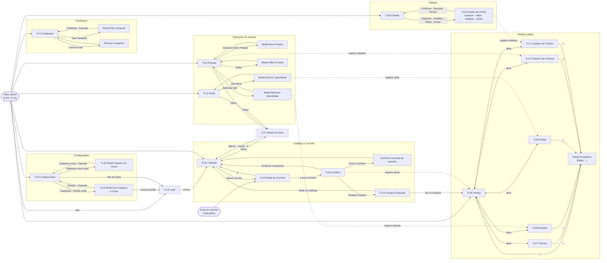

# Vastiny

> Especificação de design para geração automática das telas de front-end (Figma / Google Stitch / Claude Code).
> Fontes: planilha de briefing (abas Identificação do Projeto, Requisitos Funcionais, User Stories, Persona, Paleta de Cores, Tom de Voz, Conteúdo das Páginas, Telas do Software) e 16 wireframes de baixa fidelidade (TL01–TL16).
> Convenções deste documento: `token` = nome de token de design; ✅/❌ = resultado do cálculo de contraste WCAG 2.1 feito a partir dos HEX; "Revisão 2" = decisões da equipe aplicadas sobre a primeira versão (registradas em "Registro de decisões"). Telas sem wireframe (TL17–TL20) foram definidas nesta revisão a partir do padrão visual das demais.

## Visão geral

| Item | Definição |
|---|---|
| Produto | Vastiny |
| Contexto de negócio | Auto elétrica com pouca tecnologia no negócio |
| Problema | A equipe da auto elétrica tem dificuldade para organizar as vendas e o estoque. |
| Proposta de valor | Organize seu estoque e visualize suas vendas através de dashboards. |
| Público-alvo | Auto elétricas (Persona P01: proprietário e equipe) e demais empresas que precisam controlar estoque e vendas. Usuário autenticado; não há níveis de permissão diferentes entre contas. |
| Plataforma | Web |
| Dispositivo de referência do layout | Desktop 1440×900 |
| Tecnologias previstas no front-end | React 19.2.7, JavaScript, CSS (mínimo exigido) |
| Referências visuais (benchmark) | Inventory Dashboard (React); InApp — Dashboard de estoque |
| Ferramenta de destino | Claude Code |
| Escopo funcional | Catálogo e carrinho (vendas), clientes, histórico (6 abas), dashboard, entrada e saída de estoque, configurações e cadastro de conta. |

### Requisitos não funcionais mínimos

- **Stack:** React 19.2.7 + JavaScript (sem TypeScript) + CSS puro; componentes funcionais com hooks; um arquivo CSS por componente ou módulo CSS.
- **Tokens como variáveis CSS:** todos os tokens deste documento viram *custom properties* em `:root` (ex.: `--cor-primaria`, `--espaco-16`, `--raio-12`), usadas por todos os componentes.
- **Foco em desktop** (1440×900), com adaptação responsiva básica; tipografia e medidas alinhadas ao site institucional que está sendo construído à parte.
- **Acessibilidade:** WCAG 2.1 AA (seção Acessibilidade).
- **Ícones:** biblioteca `lucide-react` (ver "Ícones" em Componentes).
- **Dados:** categorias, critérios de estado de estoque e demais dados vêm do banco; o front-end apenas exibe os valores recebidos.

### Mapa de telas

| ID | Tela | Prioridade | Wireframe |
|---|---|---|---|
| TL01 | Catálogo | Alta | `wireframe-TL01-catalogo.png` |
| TL02 | Modal do Carrinho | Alta | `wireframe-TL02-modal_carrinho.png` |
| TL03 | Carrinho | Alta | `wireframe-TL03-carrinho.png` |
| TL04 | Clientes | Alta | `wireframe-TL04-cliente.png` |
| TL05 | Modais de Cliente | Alta | `wireframe-TL05-modais_cliente.png` |
| TL06 | Histórico de Vendas | Alta | `wireframe-TL06-historico_vendas.png` |
| TL07 | Histórico de Clientes | Média | `wireframe-TL07-historico_cliente.png` |
| TL08 | Histórico de Entradas | Alta | `wireframe-TL08-historico_entrada.png` |
| TL09 | Histórico de Saídas | Alta | `wireframe-TL09-historico_saida.png` |
| TL10 | Histórico de Cadastro de Produtos | Média | `wireframe-TL10-historico_cadastroProduto.png` |
| TL11 | Histórico de Cadastro de Clientes | Média | `wireframe-TL11-historico_cadastroCliente.png` |
| TL12 | Dashboard | Alta | `wireframe-TL12-dashboard.png` |
| TL13 | Entrada | Alta | `wireframe-TL13-entrada_e_modais.png` |
| TL14 | Saída | Alta | `wireframe-TL14-saida_e_modal.png` |
| TL15 | Configurações | Alta | `wireframe-TL15-configuracoes.png` (conteúdo SVG) |
| TL16 | Modal de Cadastro de Conta | Média (modal de TL15) | `wireframe-TL16-modal_cadastroConta.png` |
| TL17 | Modal de Filtros (Catálogo, Entrada, Saída) | Média | definida nesta revisão (sem wireframe) |
| TL18 | Login | Alta | definida nesta revisão (sem wireframe) |
| TL19 | Compra Finalizada (modal) | Alta | definida nesta revisão (sem wireframe) |
| TL20 | Modais de Categoria e de Conta (Configurações) | Média | definida nesta revisão (sem wireframe) |

## Persona

### P01 — Gabriel da Silva (persona do sistema)

| Campo | Conteúdo do briefing |
|---|---|
| Idade / ocupação | 31 anos, proprietário de auto elétrica |
| Contexto | Precisa modernizar o gerenciamento de estoque e vendas. |
| Perfil (coluna "Objetivos" da planilha) | Sobrecarregado; preocupado; organizado; aberto a novas possibilidades; expansionista; sem conhecimento tecnológico avançado; impaciente. |
| Dores | Ausência de controle de estoque digital; sobrecarga de processos manuais; ausência de monitoramento estatístico de vendas; dificuldade de expansão; atraso no atendimento; falta de presença online. |
| Familiaridade digital | Iniciante |
| Dispositivo mais usado | Desktop |
| Acessibilidade | Prefere interfaces minimalistas; gosta de coisas simples. |
| Frase | "Se a ferramenta for complicada, volto pro papel." |

**Implicações de design**

- **Minimalismo funcional:** uma tarefa principal por tela, poucos elementos concorrendo; nada de ornamento sem função.
- **Poucos cliques:** ações frequentes (adicionar ao carrinho, finalizar compra, dar baixa, adicionar quantidade) ficam visíveis no próprio card/linha, sem menus escondidos.
- **Impaciência:** feedback imediato a cada ação (resumo do carrinho e totais atualizam na hora; estados de carregamento visíveis).
- **Iniciante digital:** rótulos em português simples, mesmos nomes em menu, título e botões; confirmação explícita antes de excluir.
- **Substituir o papel:** tabelas e históricos devem ser tão diretos de ler quanto uma planilha ou caderno (colunas nomeadas, valores alinhados, datas `dd/mm/aaaa`).
- **Dashboard para quem não é analista:** indicadores em cartões grandes, estados de estoque com texto + cor (Crítico, Ruim, Médio, Bom).
- **Desktop primeiro:** layout de referência 1440×900; a adaptação para telas menores é básica e secundária.

### P02 — Hernesto Santos (fora do escopo)

Hernesto (cliente) usará apenas o site institucional, desenvolvido à parte. Não gera requisitos nem telas para o Vastiny e foi removido desta especificação.

## Design Tokens

### Cores

HEX e papel vêm da planilha (aba Paleta de Cores), exceto `cor-primaria`, definida na Revisão 2 (azul próximo do hover, porém distinto). Os contrastes foram **recalculados a partir dos HEX** (WCAG 2.1: texto normal ≥ 4,5:1; texto grande e componentes de UI ≥ 3:1) porque os valores da planilha divergem dos cálculos.

| Token | HEX | Papel | Contraste (calculado) | Planilha dizia |
|---|---|---|---|---|
| `cor-primaria` | `#0052CC` | Botões principais, item ativo do menu, foco e elementos de ação | Texto branco: 6,82:1 ✅ · sobre `cor-fundo`: 6,58:1 ✅ | — (definida na Revisão 2) |
| `cor-primaria-hover` | `#0747A6` | Estado hover de botões primários (mais escuro que `cor-primaria`) | Texto branco: 8,53:1 ✅ · sobre `cor-fundo`: 8,24:1 ✅ | 15,3:1 |
| `cor-secundaria` | `#5243AA` | Ações secundárias e elementos complementares | Texto branco: 7,66:1 ✅ · sobre `cor-fundo`: 7,39:1 ✅ | 7,3:1 |
| `cor-fundo` | `#FAFBFC` | Fundo geral da aplicação | `cor-texto` sobre ela: 13,61:1 ✅ | 2,6:1 ❌ (par não usado) |
| `cor-superficie` | `#FFFFFF` | Fundo de cartões, modais e painéis | `cor-texto` sobre ela: 14,10:1 ✅ | 13,9:1 |
| `cor-texto` | `#172B4D` | Texto principal | 13,61:1 sobre `cor-fundo` ✅ · 14,10:1 sobre `cor-superficie` ✅ | 15,3:1 |
| `cor-texto-secundario` | `#5E6C84` | Texto auxiliar e metadados | 5,13:1 sobre `cor-fundo` ✅ · 5,31:1 sobre `cor-superficie` ✅ | 7,6:1 |
| `cor-borda` | `#DFE1E6` | Separadores e contornos decorativos (cartões, linhas de tabela) | 1,26:1 sobre `cor-fundo`; 1,31:1 sobre `cor-superficie` — não serve de limite de campo (exige 3:1) | 12,4:1 |
| `cor-sucesso` | `#00875A` | Confirmações e status positivo (estado "Bom") | Texto branco sobre ela: 4,55:1 ✅ · como texto sobre `cor-superficie`: 4,55:1 ✅ · sobre `cor-fundo`: 4,39:1 ❌ | 13,8:1 |
| `cor-alerta` | `#FF991F` | Avisos e atenção (estado "Ruim") | `cor-texto` sobre ela: 6,60:1 ✅ · texto branco: 2,14:1 ❌ | 6,2:1 |
| `cor-erro` | `#DE350B` | Erros, validações negativas e ações destrutivas (estado "Crítico") | Texto branco sobre ela: 4,55:1 ✅ · como texto sobre `cor-superficie`: 4,55:1 ✅ · sobre `cor-fundo`: 4,39:1 ❌ | 2,6:1 ❌ |

**Regras de uso derivadas dos contrastes (obrigatórias):**

1. Texto sobre `cor-alerta` e sobre `cor-estado-medio` é sempre `cor-texto` (nunca branco).
2. Texto sobre `cor-primaria`, `cor-primaria-hover`, `cor-sucesso`, `cor-erro` e `cor-secundaria` é branco (`cor-superficie`).
3. Texto de erro ou de sucesso só é aplicado sobre `cor-superficie` (cartões e modais), nunca diretamente sobre `cor-fundo`.
4. Limite visual de campos de formulário usa `cor-texto-secundario` (5,31:1 ✅); `cor-borda` fica restrita a divisórias e contornos decorativos.
5. Estado nunca é comunicado só por cor: sempre acompanha texto (ex.: "Crítico") e/ou ícone/forma.

**Tokens de cor adicionais (definidos na Revisão 2; a equipe pode ajustá-los depois da construção, mantendo os contrastes):**

| Token | HEX | Uso | Contraste |
|---|---|---|---|
| `cor-estado-medio` | `#FFC400` | Selo e segmento "Médio" do estoque | `cor-texto` sobre ela: 8,83:1 ✅ (segmento de gráfico leva borda 1 px `cor-texto`, pois contra o fundo tem 1,6:1) |
| `cor-aba-vendas` | `#F3E3DC` | Aba "Vendas" ativa e fundo da tabela da aba | `cor-texto`: 11,3:1 ✅ |
| `cor-aba-clientes` | `#FFF3C4` | Aba "Clientes" | `cor-texto`: 12,67:1 ✅ |
| `cor-aba-entrada` | `#E6DEFF` | Aba "Entrada" | `cor-texto`: 10,92:1 ✅ |
| `cor-aba-saida` | `#F9DDF9` | Aba "Saída" | `cor-texto`: 11,24:1 ✅ |
| `cor-aba-cadastro-produtos` | `#D3F5DC` | Aba "Cadastro de Produtos" | `cor-texto`: 12,0:1 ✅ |
| `cor-aba-cadastro-clientes` | `#D0F0F7` | Aba "Cadastro de Clientes" | `cor-texto`: 11,74:1 ✅ |
| `cor-grafico-1` … `cor-grafico-7` | `#0052CC`, `#5243AA`, `#00875A`, `#C25100`, `#DE350B`, `#008DA6`, `#6B778C` | Barras do gráfico "Categorias mais vendidas" (a 7ª, cinza, é "Outros") | Todas ≥ 3,9:1 contra `cor-superficie` ✅ |

Nas abas, `cor-texto-secundario` não deve ser usado como texto (contraste entre 4,1:1 e 4,8:1).

### Tipografia

Família: **Inter** (todas as funções), com fallback `system-ui, sans-serif`. Escala da planilha, com `texto-corpo-pequeno` e `texto-label` elevados de 12 para 13 px por legibilidade (permitido na Revisão 2). Alinhar a família e as medidas ao site institucional quando o guia dele estiver disponível.

| Token | Peso | Tamanho | Altura de linha | Uso |
|---|---|---|---|---|
| `texto-h1` | 700 | 28 px | 1,25 | Título principal da tela — um por tela |
| `texto-h2` | 600 | 22 px | 1,3 | Seções dentro de páginas |
| `texto-h3` | 600 | 18 px | 1,35 | Subtítulos, títulos de cartão/modal, nomes de listas |
| `texto-corpo` | 400 | 14 px | 1,5 | Parágrafos, descrições, células de tabela |
| `texto-corpo-pequeno` | 400 | 13 px | 1,4 | Metadados, timestamps, legendas (nunca conteúdo essencial) |
| `texto-label` | 500 | 13 px | 1,2 | Rótulos de formulário, etiquetas |
| `texto-botao` | 600 | 14 px | 1 | Texto de botões |
| `texto-link` | 500 | 14 px | 1,5 | Links; sublinhado no hover |

### Espaçamento

Escala base de 4 px, definida para o produto (foco em desktop).

| Token | Valor | Uso típico |
|---|---|---|
| `espaco-4` | 4 px | Ícone ↔ texto |
| `espaco-8` | 8 px | Entre elementos relacionados |
| `espaco-12` | 12 px | Padding interno de botão (vertical) e célula de tabela |
| `espaco-16` | 16 px | Padding de cartão; gap entre campos |
| `espaco-24` | 24 px | Gutter do grid; gap entre cartões |
| `espaco-32` | 32 px | Entre seções da tela |
| `espaco-48` | 48 px | Margens externas de página (desktop) |

### Raio de borda

Os wireframes mostram cantos arredondados em botões, campos, cartões e modais.

| Token | Valor | Uso |
|---|---|---|
| `raio-8` | 8 px | Campos, botões, linhas de tabela |
| `raio-12` | 12 px | Cartões, itens de menu |
| `raio-16` | 16 px | Modais, painéis, contêineres de tabela |
| `raio-total` | 999 px | Selos de estado ("Crítico", "Ruim", "Médio", "Bom") |

### Sombras

| Token | Valor | Uso |
|---|---|---|
| `sombra-nenhuma` | none | Padrão: cartões e tabelas usam borda `cor-borda` |
| `sombra-modal` | `0 8px 24px rgba(23, 43, 77, 0.16)` | Modais e painéis de detalhes |
| `sombra-foco` | anel de 2 px `cor-primaria` com deslocamento de 2 px | Indicador de foco visível (todos os controles) |

## Tom de Voz

### Atributos (planilha)

| Atributo | Na prática | Exemplo "faça" (planilha) | Exemplo "não faça" (planilha) | Aplicação |
|---|---|---|---|---|
| **Acolhedor** | Tratamos o usuário como alguém que queremos ajudar, não como um número. | "Bem-vindo de volta, Lucas! Você tem 3 tarefas para hoje." | "Usuário autenticado. Há 3 itens pendentes." | Saudações, dashboard |
| **Direto** | Comunicamos de forma objetiva, sem rodeios. O usuário encontra a informação rapidamente. | "Cartão movido para Concluído." | "A ação de movimentação do item selecionado foi processada com êxito e o status foi atualizado." | Notificações, confirmações |
| **Claro** | Evitamos jargões técnicos e explicamos erros de forma compreensível. | "Não conseguimos salvar. Verifique sua conexão e tente novamente." | "Erro 500: Falha na requisição POST /api/cards." | Mensagens de erro |

> Os exemplos da planilha pertencem a outro contexto de produto; os atributos são mantidos e os exemplos aplicados ao Vastiny estão na tabela seguinte (aprovados na Revisão 2).

### Regras de escrita

1. Português do Brasil, frases curtas, verbo no início dos botões ("Adicionar ao Carrinho", "Finalizar Compra", "Dar Baixa").
2. Usar sempre o mesmo nome para a mesma coisa: "Carrinho", "Cliente", "Entrada", "Saída", "Estoque", "Produto".
3. Confirmar a ação em uma frase, dizendo o que aconteceu ("Conta cadastrada com sucesso.").
4. Erros dizem **o que houve e o que fazer**, sem códigos técnicos, sem culpar o usuário e apontando o campo a corrigir.
5. Estados vazios dizem o que não há e qual é o próximo passo possível.
6. Datas no formato `dd/mm/aaaa`; valores em reais no formato `R$ 0,00`; quantidades com unidade ("2 unidades").
7. Textos de botões e títulos exatamente como em cada tela (copy oficial da aba Conteúdo das Páginas).

### Faça / não faça aplicados ao Vastiny

Textos de estados vazios, erros e validações foram criados nesta especificação (aprovados na Revisão 2).

| Contexto | Faça | Não faça |
|---|---|---|
| Botão (copy oficial) | "Adicionar ao Carrinho" · "Finalizar Compra" · "Dar Baixa" · "Cadastrar Novo Cliente" | "Submeter operação" · "Efetuar baixa de item" · "Executar" |
| Saudação (copy oficial) | "Bem-vindo!" + nome do usuário | "Usuário autenticado" |
| Confirmação (copy oficial) | "Conta cadastrada com sucesso." | "A operação de cadastro foi processada com êxito." |
| Confirmação de exclusão (copy oficial) | "Tem certeza que deseja excluir o cliente '[Nome do cliente]'?" | "Confirmar remoção do registro?" |
| Erro de gravação (planilha) | "Não conseguimos salvar. Verifique sua conexão e tente novamente." | "Erro 500: falha na requisição." |
| Erro de campo | "Informe o telefone do cliente." | "Campo inválido." |
| Erro de quantidade | "A quantidade não pode ser maior que o estoque disponível." | "Valor fora do intervalo permitido." |
| Erro de senha | "As senhas não são iguais. Digite novamente." | "Confirmação de credencial divergente." |
| Estado vazio — catálogo | "Nenhum produto encontrado. Tente buscar por outro nome." | "Sem dados." |
| Estado vazio — carrinho | "Este carrinho está vazio. Adicione produtos pelo catálogo." | "Carrinho nulo." |
| Estado vazio — clientes | "Nenhum cliente cadastrado. Use “Cadastrar Novo Cliente” para começar." | "Lista vazia." |
| Estado vazio — histórico | "Nenhum registro por aqui ainda." | "0 resultados retornados." |

## Componentes

Todos os componentes usam `texto-*` da tipografia, `espaco-*`, `raio-*` e os tokens de cor acima. Estados universais: **foco** = `sombra-foco` visível em todo controle interativo; **desabilitado** = texto `cor-texto-secundario`, fundo `cor-borda`, cursor `not-allowed`, sem hover; **carregando** = rótulo substituído por indicador de progresso + `aria-busy="true"`, controle inativo.

### Botão

**Anatomia:** contêiner (`raio-8`) · rótulo (`texto-botao`) · ícone opcional à esquerda (`espaco-8` do rótulo).
**Tamanhos:** altura mínima 44 px (área de toque), padding horizontal `espaco-16`. Botão só-ícone: 44×44 px.

| Variante | Fundo | Texto | Borda | Uso (copy oficial) |
|---|---|---|---|---|
| Primário | `cor-primaria` | `cor-superficie` | nenhuma | "Adicionar ao Carrinho", "Finalizar Compra", "Confirmar", "Cadastrar", "Cadastrar conta", "Salvar alterações", "Cadastrar Novo Cliente", "Cadastrar Novo Produto", "Adicionar Qtd.", "Dar Baixa", "Ir para Carrinho", "Aplicar filtros", "Entrar" |
| Secundário | `cor-superficie` | `cor-texto` | 1 px `cor-texto-secundario` | "Cancelar", "Trocar Carrinho", "Continuar comprando", "Editar", "Alterar carrinho" (como link), "Filtro Temporal", "Filtros", "Limpar filtros", "Sair da conta" |
| Destrutivo | `cor-erro` | `cor-superficie` | nenhuma | "Excluir Carrinho", "Excluir do Carrinho", "Excluir conta" |
| Ícone | transparente | `cor-texto` | 1 px `cor-texto-secundario` | Lupa, carrinho, fechar (X), "+" (novo carrinho/categoria), "…" (detalhes no Histórico), Detalhes/Editar/Excluir por linha, lixeira (ícones definidos em "Ícones") |
| Passo (stepper) | `cor-superficie` | `cor-texto` | 1 px `cor-texto-secundario` | "−", "+" na quantidade; "-1" e "+1" nos modais de entrada e saída |

| Estado | Primário | Secundário | Destrutivo |
|---|---|---|---|
| Padrão | conforme tabela | conforme tabela | conforme tabela |
| Hover | fundo `cor-primaria-hover`, texto `cor-superficie` | fundo `cor-fundo` | fundo `cor-erro` com 90 % de opacidade sobre `cor-superficie` |
| Foco | `sombra-foco` | `sombra-foco` | `sombra-foco` |
| Ativo (pressionado) | `cor-primaria-hover`, deslocamento 1 px | fundo `cor-borda` | `cor-erro` com 80 % de opacidade |
| Desabilitado | padrão universal | padrão universal | padrão universal |
| Carregando | indicador no lugar do rótulo | idem | idem |
| Erro | não se aplica (erro é exibido na mensagem da ação) | — | — |

### Campo de formulário

**Anatomia:** rótulo acima (`texto-label`, `cor-texto`) · campo (`raio-8`, altura mínima 44 px, padding `espaco-12`/`espaco-16`, texto `texto-corpo`) · texto de ajuda opcional (`texto-corpo-pequeno`, `cor-texto-secundario`) · mensagem de erro (`texto-corpo-pequeno`, `cor-erro`, sobre `cor-superficie`, com ícone).
**Tipos usados:** texto (Nome, Telefone, Código, Nome de usuário), e-mail, senha, número/valor em reais (Preço, Quantidade, Desconto, Valor Compra/Venda), área de texto (Descrição, Justificativa), pesquisa (campo + botão-lupa), data (Data Início, Data Fim), caixa de seleção (filtro de categoria).
**Tamanho:** largura 100 % do contêiner; em formulários de duas colunas, 2 campos por linha a partir de 768 px.

| Estado | Fundo | Borda | Texto |
|---|---|---|---|
| Padrão | `cor-superficie` | 1 px `cor-texto-secundario` | `cor-texto`; placeholder `cor-texto-secundario` |
| Hover | `cor-superficie` | 1 px `cor-texto` | idem |
| Foco | `cor-superficie` | 2 px `cor-primaria` + `sombra-foco` | idem |
| Ativo (digitando) | igual ao foco | igual ao foco | `cor-texto` |
| Desabilitado | `cor-fundo` | 1 px `cor-borda` | `cor-texto-secundario` |
| Carregando | `cor-fundo` | 1 px `cor-borda` | indicador de progresso à direita |
| Erro | `cor-superficie` | 2 px `cor-erro` | mensagem de erro abaixo, ligada ao campo por `aria-describedby`; `aria-invalid="true"` |

### Card de produto (Catálogo, Entrada, Saída)

**Anatomia (de cima para baixo):** imagem do produto (proporção do wireframe, `raio-12`) · categoria (`texto-corpo-pequeno`, `cor-texto-secundario`; exigida pelo RF01) · linha "`[R$ 0,00] | [0] Qtd`" (preço por unidade | quantidade em estoque; `texto-corpo`, `cor-texto`) · nome do produto (`texto-corpo`, 600) · botão(ões) de ação.
**Variantes:** Catálogo (1 botão: "Adicionar ao Carrinho" ↔ "Excluir do Carrinho"); Entrada (2 botões: "Editar" e "Adicionar Qtd."); Saída (1 botão: "Dar Baixa").
**Tamanho:** 3 cartões por linha em desktop (wireframes); largura fluida; `espaco-24` entre cartões; padding `espaco-16`.

| Estado | Descrição |
|---|---|
| Padrão | `cor-superficie`, borda 1 px `cor-borda`, `raio-12` |
| Hover | borda 1 px `cor-texto-secundario` |
| Foco | `sombra-foco` no botão focado |
| Ativo — no carrinho (só Catálogo) | botão vira "Excluir do Carrinho" (destrutivo) |
| Desabilitado | estoque 0: botão "Adicionar ao Carrinho" desabilitado (regra RF01/RF03: quantidade não pode exceder o estoque) |
| Carregando | imagem e textos em bloco de esqueleto `cor-borda` |
| Erro | mensagem "Não conseguimos carregar os produtos. Verifique sua conexão e tente novamente." com botão secundário "Tentar novamente" |

### Cabeçalho de página

**Anatomia:** título da tela (`texto-h1`, `cor-texto`) à esquerda · à direita: campo de pesquisa com botão-lupa (telas TL01, TL03, TL06–TL11, TL13, TL14) · botão-ícone de carrinho (TL01, TL03, TL06–TL11) · botão de ação principal da tela quando existir ("Cadastrar Novo Cliente", "Cadastrar Novo Produto", "Filtro Temporal").
**Comportamento:** o botão-ícone de carrinho sempre abre o modal do carrinho (TL02), que oferece "Ir para Carrinho" para abrir a tela inteira (TL03). **Estados:** fica preenchido com `cor-primaria` (ícone `cor-superficie`) quando a tela atual é o Carrinho (TL03); os demais estados seguem o botão.

### Navegação lateral

**Anatomia (de cima para baixo, conforme wireframes):**
1. Saudação: "Bem-vindo!" e, abaixo, o nome do usuário, cada um sublinhado por linha `cor-borda`.
2. Itens: "Catálogo", "Clientes", "Histórico".
3. Rótulo de grupo "Operações" (`texto-label`) com os itens "Entrada" e "Saída".
4. Itens: "Dashboard", "Configurações".
5. No rodapé da barra: "Sair".

**Tamanho:** largura fixa em desktop; item com altura mínima 44 px, `raio-12`, texto `texto-corpo` 600 centralizado como nos wireframes.

| Estado do item | Descrição |
|---|---|
| Padrão | fundo `cor-superficie`, borda 1 px `cor-texto-secundario`, texto `cor-texto` |
| Hover | fundo `cor-fundo` |
| Foco | `sombra-foco` |
| Ativo (seção atual) | fundo `cor-primaria`, sem borda, texto `cor-superficie`, `aria-current="page"` |
| Desabilitado | não se aplica |
| Carregando | não se aplica |
| Erro | não se aplica |

Observação: em cada tela o item correspondente à seção fica ativo; em TL02 e TL03 (fluxo de venda) o item ativo é "Catálogo".

### Abas do Histórico

**Anatomia:** 6 abas em linha: "Vendas", "Clientes", "Entrada", "Saída", "Cadastro de Produtos", "Cadastro de Clientes" (`texto-corpo`; todas no mesmo tamanho).
**Estados:** padrão (`cor-superficie`, borda `cor-texto-secundario`), hover (`cor-fundo`), foco (`sombra-foco`), ativa (fundo `cor-aba-*` da própria aba, borda 2 px `cor-texto`, peso 600, `role="tab"` + `aria-selected="true"`), desabilitada/carregando/erro: não se aplicam. Em telas estreitas as abas rolam horizontalmente.

### Tabela / lista

**Anatomia:** cabeçalho de colunas (`texto-label` em 600, `cor-texto-secundario`) · linhas (`cor-superficie`, borda 1 px `cor-borda`, `raio-8`, altura mínima 48 px) · coluna final de ações (botão "…" ou botões por linha).
**Variantes:** (a) lista de histórico em contêiner (`raio-16`); (b) itens do carrinho (com stepper, campo de desconto e lixeira); (c) lista de clientes (com 3 ações); (d) estoque do dashboard (com selo de estado e ícones de ordenação no cabeçalho, como no wireframe).
**Estados:** padrão; hover da linha (`cor-fundo`); foco (`sombra-foco` no botão da linha); linha selecionada (borda 2 px `cor-primaria-hover`); carregando (linhas de esqueleto `cor-borda`); vazio (mensagem centralizada em `cor-texto-secundario`); erro (mensagem + "Tentar novamente"). Em telas estreitas cada linha vira um cartão empilhado com `rótulo: valor`.

### Indicador (KPI) e resumo

**Anatomia:** cartão `raio-12`, borda `cor-borda`, rótulo (`texto-label`) acima do valor (`texto-h2`, `cor-texto`).
**Usos:** resumo do carrinho no Catálogo ("Carrinho Atual", "Valor Total", "Quantidade de Produtos" em faixa horizontal) · resumo financeiro do carrinho ("Subtotal", "Descontos", "Total Final") · 4 indicadores do Dashboard.
**Estados:** padrão; carregando (esqueleto); vazio ("—" em `cor-texto-secundario`); erro (valor substituído por "Indisponível").

### Selo de estado de estoque

Pílula `raio-total`, `texto-label`, padding `espaco-4`/`espaco-12`.

| Texto | Fundo | Texto do selo | Observação |
|---|---|---|---|
| Crítico | `cor-erro` | `cor-superficie` | 4,55:1 ✅ |
| Ruim | `cor-alerta` | `cor-texto` | 6,60:1 ✅ |
| Médio | `cor-estado-medio` | `cor-texto` | 8,83:1 ✅ |
| Bom | `cor-sucesso` | `cor-superficie` | 4,55:1 ✅ |

### Modal

**Anatomia:** sobreposição escurecida (cor-texto a 50 % de opacidade) · painel `cor-superficie`, `raio-16`, `sombra-modal`, padding `espaco-24` · título (`texto-h3`) · conteúdo · rodapé com botões (Cancelar à esquerda, ação principal à direita, como nos wireframes) · botão-ícone fechar (X) quando o wireframe o mostra (TL02 e painéis de detalhes do Histórico).
**Variantes:** formulário (TL05, TL13, TL14, TL16) · confirmação (exclusão de cliente) · painel de detalhes (Histórico, detalhes do cliente) · modal de tabela larga (TL02) · seletor de período (TL12) · lista de seleção (filtro de categoria, TL12).
**Tamanhos:** pequeno (confirmação, ~480 px), médio (formulários, ~640 px), grande (TL02 e detalhes de histórico, ~960 px); em telas < 768 px ocupa 100 % da largura e altura.
**Comportamento:** foco preso dentro do modal; `Esc` fecha; foco retorna ao elemento que o abriu; `role="dialog"`, `aria-modal="true"`, `aria-labelledby` apontando para o título.
**Estados:** padrão; enviando (botão principal em carregando, demais controles desabilitados); erro (mensagem no topo do formulário, com foco movido para o primeiro campo inválido).

### Campo de desconto duplo (R$ e %)

**Anatomia:** dois campos lado a lado dentro da célula "Desconto" de cada item do carrinho: prefixo "R$" (valor em reais) e sufixo "%" (percentual). Alterar um recalcula o outro automaticamente, com base no valor da linha (quantidade × preço por unidade).
**Regras:** desconto em R$ entre 0,00 e o valor da linha; percentual entre 0 e 100; o desconto pode ser alterado até a finalização da venda. Ao digitar um valor inválido, o campo mostra erro ("O desconto não pode ser maior que o valor do produto.").
**Estados:** padrão, hover, foco, desabilitado (carrinho finalizado), erro — como o *Campo de formulário*. Altura 44 px; os dois campos somam a largura da coluna.

### Notificação (toast)

Mensagem curta no canto superior direito, sobre `cor-superficie`, `raio-12`, `sombra-modal`, com ícone e texto (`texto-corpo`), some em 5 s e pode ser fechada. Variantes: sucesso (borda esquerda 4 px `cor-sucesso`, `role="status"`), erro (`cor-erro`, `role="alert"`), informação (`cor-primaria`).

### Ícones

Biblioteca `lucide-react` (traço 2 px, 20 px dentro de alvo de 44 px). Sempre com nome acessível (`aria-label`) quando não houver texto. Escolhidos os ícones mais usados no mercado para cada função:

| Função | Ícone (lucide-react) |
|---|---|
| Pesquisar | `Search` (lupa) |
| Carrinho | `ShoppingCart` |
| Fechar | `X` |
| Adicionar / novo | `Plus` |
| Diminuir / aumentar quantidade | `Minus` / `Plus` |
| Excluir / remover | `Trash2` (lixeira) |
| Editar | `Pencil` (lápis) |
| Ver detalhes (Clientes) | `Eye` (olho) |
| Mais informações no Histórico | `MoreHorizontal` ("…") |
| Filtros | `SlidersHorizontal` (botão "Filtros") · `Filter` (funil do painel "Produtos mais Vendidos") |
| Calendário / período | `Calendar` |
| Ordenar colunas | `ArrowUpDown` |
| Lista suspensa | `ChevronDown` |
| Sair | `LogOut` |
| Sucesso / erro / aviso | `CheckCircle2` / `AlertCircle` / `AlertTriangle` |

### Gráficos (Dashboard)

- **Barras — "Categorias mais vendidas":** barras nas cores `cor-grafico-1` a `cor-grafico-7`, eixo vertical com valores, categorias no eixo horizontal, valor em reais acima de cada barra. Estados: carregando (esqueleto), vazio ("Sem vendas no período selecionado."), erro.
- **Rosca — "Níveis de Estoque Atual":** centro com "Total Produto" e a quantidade; legenda ao lado com cor, nível (Bom/Médio/Ruim/Crítico), quantidade e percentual. Cada segmento também usa um padrão/forma distinta (o wireframe usa marcadores diferentes por segmento) para não depender só de cor.
- Todo gráfico tem alternativa textual e tabela equivalente acessível (ver Acessibilidade).

## Telas

### Estrutura comum a todas as telas

**Casca da aplicação (TL01–TL15):** barra lateral fixa à esquerda (componente *Navegação lateral*) + área de conteúdo à direita sobre `cor-fundo`. Referência: 1440×900.

**Grid e breakpoints (foco em desktop 1440×900; adaptação responsiva básica e secundária):**

| Token | Largura | Colunas | Gutter | Margem da página | Barra lateral |
|---|---|---|---|---|---|
| `bp-base` | 0–767 px | 4 | `espaco-16` | `espaco-16` | Oculta; abre como gaveta por botão de menu |
| `bp-768` | ≥ 768 px | 8 | `espaco-24` | `espaco-24` | Gaveta |
| `bp-1024` | ≥ 1024 px | 12 | `espaco-24` | `espaco-32` | Fixa (256 px) |
| `bp-1440` | ≥ 1440 px (referência) | 12 | `espaco-24` | `espaco-48` | Fixa (256 px) |

**Comportamento responsivo padrão:**
- Cabeçalho de página: título em linha própria; pesquisa e botões descem para a linha seguinte em `bp-base`.
- Cartões de produto: 1 coluna em `bp-base`, 2 em `bp-768`, 3 em `bp-1024` e acima.
- Tabelas: em `bp-base` cada linha vira cartão empilhado (`rótulo: valor`); em `bp-768` rolagem horizontal dentro do contêiner da tabela, sem rolagem da página.
- Modais: 100 % da largura e altura em `bp-base`; centralizados com largura máxima em `bp-768` e acima.
- Alvos de toque ≥ 44×44 px em todos os breakpoints.

**Estados comuns:** *carregando* (esqueletos `cor-borda` no lugar do conteúdo e `aria-busy="true"` na região), *vazio* (mensagem centralizada em `cor-texto-secundario`), *erro* ("Não conseguimos carregar as informações. Verifique sua conexão e tente novamente." + botão secundário "Tentar novamente").

**Copy da navegação lateral (TL01, TL03–TL15):** "Bem-vindo!" · "[Nome do usuário]" · "Catálogo" · "Clientes" · "Histórico" · "Operações" · "Entrada" · "Saída" · "Dashboard" · "Configurações" · "Sair". Nos wireframes o nome de exemplo é "Cleber".

### Requisitos funcionais e user stories adicionais (Revisão 2)

Definidos para cobrir telas, fluxos e regras que o briefing citava sem requisito. Persona: usuário autenticado (Gabriel da Silva). Não há níveis de permissão: toda conta autenticada acessa todas as funcionalidades.

| ID | Requisito | Tela(s) | User story | Regra / critério |
|---|---|---|---|---|
| RF40 | Autenticar usuário | TL18 | US40 — Como usuário, quero entrar com e-mail e senha para acessar o sistema. | Credenciais válidas levam ao Catálogo; inválidas mostram erro sem dizer qual campo está errado. |
| RF41 | Editar dados da conta | TL15 | US41 — Como usuário, quero atualizar nome, e-mail e senha para manter meu acesso correto. | Troca de senha exige a senha atual; e-mail válido e único. |
| RF42 | Gerenciar categorias de produtos (criar, editar, excluir) | TL15, TL20 | US42 — Como usuário, quero cadastrar e manter categorias para organizar o catálogo. | Nome obrigatório e único; categoria com produtos associados não pode ser excluída. Os critérios de estado de estoque de cada categoria vêm do banco. |
| RF43 | Encerrar sessão | menu, TL15 | US43 — Como usuário, quero sair para proteger o acesso. | "Sair" e "Sair da conta" encerram a sessão e levam ao Login. |
| RF44 | Excluir a conta atual | TL15, TL20 | US44 — Como usuário, quero excluir minha conta quando não precisar mais dela. | Exige confirmação com a senha atual; após excluir, volta ao Login. |
| RF45 | Filtrar produtos | TL01, TL13, TL14, TL17 | US45 — Como usuário, quero filtrar produtos para encontrar o que preciso. | Filtros abrem em modal; seguem as informações mostradas nos cards. |
| RF46 | Vincular cliente à venda | TL03 | US46 — Como usuário, quero escolher o cliente da venda para acompanhar o histórico dele. | Padrão "Sem Cliente"; a venda aparece no histórico do cliente escolhido. |
| RF47 | Confirmar conclusão da compra | TL19 | US47 — Como usuário, quero ver a confirmação da venda para ter certeza de que foi registrada. | Mostra transação, cliente, total e lucro; oferece ver no Histórico ou voltar ao Catálogo. |
| RF48 | Ordenar a tabela de estoque do Dashboard | TL12 | US48 — Como usuário, quero ordenar a tabela por coluna para achar rápido os itens críticos. | Clique no cabeçalho alterna crescente/decrescente (`aria-sort`). |
| RF49 | Cadastrar e editar produto com imagem, categoria e valores de compra e venda | TL13 | US49 — Como usuário, quero informar categoria, imagem e valores ao cadastrar para ter o lucro calculado. | Lucro = valor de venda − valor de compra, calculado e somente leitura; complementa RF33 e RF34. |
| RF50 | Desconto em R$ e em % vinculados | TL02, TL03 | US50 — Como usuário, quero dar desconto em reais ou em percentual e ver o outro valor atualizar. | Editar um recalcula o outro; permitido até a finalização; não gera valor negativo; complementa RF07. |
| RF51 | Pesquisar no Histórico | TL06–TL11 | US51 — Como usuário, quero pesquisar nos registros da aba aberta. | Filtra a aba ativa por nome, id ou transação. |

---

## TL01 — Catálogo

**Objetivo:** exibir os produtos disponíveis e permitir adicioná-los ao carrinho.
**Perfil de acesso:** usuário autenticado · **Prioridade:** Alta · **Wireframe:** `wireframe-TL01-catalogo.png`

### Layout (de cima para baixo)

1. **Barra lateral** (esquerda): Navegação lateral com "Catálogo" ativo.
2. **Cabeçalho de página:** título "Catálogo" (`texto-h1`) à esquerda; à direita, campo de pesquisa com botão-lupa e botão-ícone de carrinho (abre o modal TL02).
3. **Faixa de resumo do carrinho** (contêiner com borda `cor-texto-secundario`, `raio-12`, `cor-superficie`): da esquerda para a direita — "Carrinho Atual: [Nome do carrinho]" · "Valor Total: [R$ 0,00]" · "Quantidade de Produtos: [0]" · link "Alterar carrinho" alinhado à direita (`texto-link`). Exemplo do wireframe: "Carrinho 029", "R$ 140,00", "6".
4. **Filtros:** botão secundário "Filtros" acima da grade; abre o modal TL17. Filtros ativos aparecem ao lado como etiquetas removíveis.
5. **Grade de cards de produto** (3 por linha em desktop, 2 linhas no wireframe).

### Grid e responsivo
12 colunas em desktop: cada card ocupa 4 colunas. Faixa de resumo: em `bp-base` os 3 indicadores empilham e o link "Alterar carrinho" vai para a última linha. Demais regras: padrão da seção "Estrutura comum".

### Copy
- Campo de pesquisa (placeholder "Pesquisar produtos") + botão com ícone de lupa.
- "Carrinho Atual: [Nome do carrinho]" · "Valor Total: [R$ 0,00]" · "Quantidade de Produtos: [0]" · "Alterar carrinho".
- Card: "[Imagem do produto]" · "[Categoria]" · "[R$ 0,00] | [0] Qtd" (preço por unidade | quantidade em estoque) · "[Nome do produto]" · botão "Adicionar ao Carrinho" (produto fora do carrinho) ou "Excluir do Carrinho" (produto já no carrinho).

### Componentes e tokens
Navegação lateral (`cor-primaria` no item ativo) · Cabeçalho de página (`texto-h1`) · Campo de pesquisa (borda `cor-texto-secundario`) · Indicador/resumo (`cor-superficie`, `raio-12`, `espaco-16`) · Card de produto (`raio-12`, `espaco-16`, gap `espaco-24`) · Botão primário e destrutivo.

### Estados
Padrão · carregando (esqueleto dos cards e da faixa de resumo) · sem produtos ("Nenhum produto encontrado. Tente buscar por outro nome.") · produto adicionado ao carrinho (botão do card muda para "Excluir do Carrinho" e a faixa de resumo atualiza valor e quantidade) · erro ao carregar (mensagem padrão + "Tentar novamente").

### Navegação
**De onde vem:** qualquer tela da navegação.
**Para onde vai:** "Alterar carrinho" → TL02 (modal do carrinho) · botão-ícone de carrinho → TL02 (modal do carrinho) · "Filtros" → TL17 · menu → TL04, TL06, TL13, TL14, TL12, TL15 · "Sair" → encerra a sessão e leva ao Login (TL18).

### Requisitos e user stories
RF01, RF02, RF03, RF04, RF05, RF10, RF45 · US01, US02, US03, US04, US05, US10, US45.

---

## TL02 — Modal do Carrinho

**Objetivo:** exibir e permitir alterar os itens do carrinho selecionado.
**Perfil de acesso:** usuário autenticado · **Prioridade:** Alta · **Wireframe:** `wireframe-TL02-modal_carrinho.png`

### Layout (de cima para baixo)
1. **Barra de ações do modal:** botão "Ir para Carrinho" (esquerda) · botão "Trocar Carrinho" · botão-ícone "+" (novo carrinho) · botão-ícone "X" (fechar, canto superior direito).
2. **Tabela de itens:** colunas "#", "Produto" (miniatura + nome + código), "Categoria", "Quantidade" (stepper "−  [n]  +"), "Preço por Unidade", "Desconto" (campo duplo: valor em "R$" e percentual em "%", vinculados), "Total", e coluna final com botão-ícone de lixeira (vermelho).
3. **Linha divisória** (`cor-borda`).
4. **Resumo financeiro** (rodapé, em uma linha): "Subtotal: [R$ 0,00]" · divisor vertical · "Descontos: [R$ 0,00] ([0]%)" (somente leitura: soma dos descontos dos itens) · "Total Final: [R$ 0,00]".

### Grid e responsivo
Modal grande (~960 px) em desktop sobre a TL01 escurecida. Em `bp-base`: tela cheia; tabela vira cartões; resumo financeiro empilha em 3 linhas; botões da barra de ações quebram em duas linhas.

### Copy
"Ir para Carrinho" · "Trocar Carrinho" · "+" · "X" · colunas "#" | "Produto" | "Categoria" | "Quantidade" | "Preço por Unidade" | "Desconto" | "Total" · "Subtotal: [R$ 0,00]" · "Descontos: [R$ 0,00]" · "Total Final: [R$ 0,00]". Exemplo coerente: 2 itens (5 × R$ 20,00 = R$ 100,00; 2 × R$ 80,00 = R$ 160,00 com desconto de R$ 10,00 = R$ 150,00) → Subtotal R$ 260,00 · Descontos R$ 10,00 (3,85 %) · Total Final R$ 250,00. Regra: Subtotal = soma de quantidade × preço; Total do item = quantidade × preço − desconto.
Estado vazio: "Este carrinho está vazio. Adicione produtos pelo catálogo."

### Componentes e tokens
Modal (variante tabela larga: `raio-16`, `sombra-modal`, `cor-superficie`) · Botão primário ("Ir para Carrinho"), secundário ("Trocar Carrinho"), ícone ("+", "X", lixeira em `cor-erro`) · Tabela (variante carrinho) · Stepper de quantidade · Campo de desconto · Indicador/resumo financeiro (`texto-h3` para "Total Final").

### Estados
Padrão · carrinho vazio · item atualizado (linha e totais recalculados) · desconto aplicado (Descontos e Total Final atualizados) · erro de validação: quantidade acima do estoque ou desconto que deixaria valor negativo ("O desconto não pode ser maior que o valor do produto.").

### Navegação
**De onde vem:** TL01 ("Alterar carrinho") ou botão-ícone de carrinho de qualquer tela que o tenha.
**Para onde vai:** "Ir para Carrinho" → TL03 · "X" → TL01 · "Trocar Carrinho" → seleciona outro carrinho (mantém o modal) · "+" → cria novo carrinho.

### Requisitos e user stories
RF05, RF06, RF07, RF50 · US05, US06, US07, US50.

---

## TL03 — Carrinho

**Objetivo:** revisar itens e valores e concluir ou excluir o carrinho.
**Perfil de acesso:** usuário autenticado · **Prioridade:** Alta · **Wireframe:** `wireframe-TL03-carrinho.png`

### Layout (de cima para baixo)
1. **Barra lateral** com "Catálogo" ativo.
2. **Cabeçalho de página:** título "Carrinho"; pesquisa com lupa; botão-ícone de carrinho **preenchido** (`cor-primaria`) indicando a tela atual.
3. **Seletor de carrinho:** controle "Trocar carrinho ∨" (lista suspensa) + botão-ícone "+" .
4. **Título da lista:** "Carrinho ([quantidade de itens])" (`texto-h3`); exemplo "Carrinho (2)".
5. **Tabela de itens** (mesma da TL02): "#", "Produto", "Categoria", "Quantidade", "Preço por Unidade", "Desconto", "Total", lixeira.
6. **Cliente da venda:** lista suspensa "Cliente" (padrão "Sem Cliente"; inclui os clientes cadastrados). **Resumo financeiro:** "Subtotal" · "Descontos" (somente leitura, em R$ e %) · "Total Final".
7. **Barra de ações** (rodapé, 3 botões distribuídos): "Excluir Carrinho" (esquerda) · "Continuar comprando" (centro) · "Finalizar Compra" (direita).

### Grid e responsivo
Conteúdo em largura total da área principal (12 colunas). Em `bp-base`: tabela em cartões; barra de ações empilhada em coluna com "Finalizar Compra" no topo.

### Copy
"Carrinho" · "Trocar carrinho" · "+" · "Carrinho ([quantidade de itens])" · "Cliente" · "Sem Cliente" · colunas como em TL02 · "Subtotal: [R$ 0,00]" · "Descontos: [R$ 0,00]" · "Total Final: [R$ 0,00]" · "Excluir Carrinho" · "Continuar comprando" · "Finalizar Compra".
Textos adicionais: confirmação de exclusão (modal pequeno) "Tem certeza que deseja excluir o carrinho '[Nome do carrinho]'? Todos os itens serão removidos." com "Cancelar" / "Confirmar" (destrutivo); sucesso → TL19; erro "Não conseguimos finalizar a compra. Verifique os itens e tente novamente."

### Componentes e tokens
Navegação lateral · Cabeçalho de página · Seletor de carrinho (campo/lista com borda `cor-texto-secundario`) · Tabela (variante carrinho) · Indicador/resumo financeiro · Botão destrutivo ("Excluir Carrinho"), secundário ("Continuar comprando") e primário ("Finalizar Compra") · Modal de confirmação.

### Estados
Padrão · carrinho vazio · atualizando itens · confirmando exclusão · compra finalizada · erro ao finalizar.

### Navegação
**De onde vem:** TL01 · TL02 ("Ir para Carrinho").
**Para onde vai:** "Continuar comprando" → TL01 (itens mantidos) · "Finalizar Compra" → TL19 (Compra Finalizada) · "Excluir Carrinho" → confirmação → TL01 · menu lateral → demais telas.

### Requisitos e user stories
RF02, RF04, RF05, RF06, RF07, RF08, RF09, RF10, RF46, RF47, RF50 · US04, US05, US06, US07, US08, US09, US10, US46, US47, US50.

---

## TL04 — Clientes

**Objetivo:** consultar clientes, quantidade de compras e ações disponíveis para cada cadastro.
**Perfil de acesso:** usuário autenticado · **Prioridade:** Alta · **Wireframe:** `wireframe-TL04-cliente.png`

### Layout (de cima para baixo)
1. **Barra lateral** com "Clientes" ativo.
2. **Cabeçalho de página:** título "Todos os clientes" à esquerda; botão primário "Cadastrar Novo Cliente" à direita.
3. **Lista de clientes:** colunas "Nome", "Telefone", "Qtd. Compras" e "Ações". Na coluna Ações, 3 botões-ícone por linha, nesta ordem: **Detalhes**, **Editar**, **Excluir**. Exemplo do wireframe: "Nicolas Mazza · 0000 · 5", "Eduardo Ribeiro · 0000 · 6", "Miguel Igor · 0000 · 3".

### Grid e responsivo
Tabela em 12 colunas (Nome 5, Telefone 3, Qtd Compras 2, Ações 2). Em `bp-base`: cartão por cliente com as 3 ações em linha ao final; botão "Cadastrar Novo Cliente" em largura total sob o título.

### Copy
"Todos os clientes" · "Cadastrar Novo Cliente" · "Nome" · "Telefone" · "Qtd. Compras" · "Ações" · "Detalhes" · "Editar" · "Excluir" (rótulos acessíveis dos ícones `Eye`, `Pencil` e `Trash2`).
Estado vazio: "Nenhum cliente cadastrado. Use “Cadastrar Novo Cliente” para começar."

### Componentes e tokens
Navegação lateral · Cabeçalho de página · Tabela (variante clientes) · Botão primário · Botões-ícone de 44×44 px (`raio-8`, borda `cor-texto-secundario`; "Excluir" com ícone em `cor-erro`).

### Estados
Padrão · carregando · sem clientes · ação selecionada (abre o modal correspondente em TL05).

### Navegação
**De onde vem:** qualquer tela da navegação.
**Para onde vai:** "Cadastrar Novo Cliente", "Detalhes", "Editar", "Excluir" → TL05 (modais).

### Requisitos e user stories
RF11, RF12, RF13, RF14, RF15 · US11, US12, US13, US14, US15.

---

## TL05 — Modais de Cliente

**Objetivo:** cadastrar, editar, consultar detalhes e confirmar a exclusão de um cliente.
**Perfil de acesso:** usuário autenticado · **Prioridade:** Alta · **Wireframe:** `wireframe-TL05-modais_cliente.png` (4 modais sobre TL04)

### Layout — 4 modais (de cima para baixo em cada um)

1. **Cadastrar Novo Cliente** (médio): título "Cadastrar Novo Cliente" → campos "Nome:", "Telefone:", "Descrição:" → rodapé: "Cancelar" (esquerda) e "Confirmar" (direita).
2. **Editar dados do Cliente** (médio): título "Editar dados do cliente" → campos preenchidos "Nome" (ex.: "Nicolas Mazza"), "Telefone" (ex.: "0000"), "Descrição" → "Cancelar" e "Confirmar".
3. **Detalhes** (médio): título "Detalhes" → nome do cliente → painel com todas as informações do cliente, incluindo a descrição. Botão "X" no canto superior direito e botão "Fechar" no rodapé; `Esc` também fecha.
4. **Confirmação de exclusão** (pequeno): texto "Tem certeza que deseja excluir o cliente '[Nome do cliente]'?" → "Cancelar" e "Confirmar" (destrutivo).

### Grid e responsivo
Modais centralizados sobre TL04 escurecida; formulários com 1 coluna e campos em largura total. Em `bp-base`: tela cheia, botões do rodapé lado a lado (50 % cada) ou empilhados se faltar largura.

### Copy
"Cadastrar Novo Cliente" · "Nome" · "Telefone" · "Descrição" · "Cancelar" · "Confirmar" · "Editar dados do cliente" · "Detalhes" · "Fechar" · "Tem certeza que deseja excluir o cliente '[Nome do cliente]'?".
Validação (regra RF12: Nome e Telefone obrigatórios): "Informe o nome do cliente." · "Informe o telefone do cliente."

### Componentes e tokens
Modal (formulário, detalhes, confirmação) · Campo de formulário (texto, área de texto para "Descrição") · Botão secundário ("Cancelar"), primário ("Confirmar"), destrutivo (confirmação de exclusão).

### Estados
Padrão · preenchendo · salvando (botão "Confirmar" em carregando) · confirmação de exclusão · erro ao salvar ("Não conseguimos salvar. Verifique sua conexão e tente novamente.").

### Navegação
**De onde vem:** TL04.
**Para onde vai:** ao confirmar, cancelar ou fechar → TL04 (lista atualizada quando houver alteração).

### Requisitos e user stories
RF12, RF13, RF14, RF15 · US12, US13, US14, US15.

---

## TL06 — Histórico de Vendas

**Objetivo:** consultar as vendas registradas e seus principais dados.
**Perfil de acesso:** usuário autenticado · **Prioridade:** Alta · **Wireframe:** `wireframe-TL06-historico_vendas.png`

### Layout (de cima para baixo)
1. **Barra lateral** com "Histórico" ativo.
2. **Cabeçalho de página:** título "Histórico"; pesquisa com lupa; botão-ícone de carrinho.
3. **Abas do Histórico:** "Vendas" (ativa) · "Clientes" · "Entrada" · "Saída" · "Cadastro de Produtos" · "Cadastro de Clientes".
4. **Contêiner da lista** (`raio-16`, com a cor da aba ativa, token `cor-aba-vendas`) contendo a tabela: "Transação" · "Cliente" · "Valor" · "Lucro" · "Qtd. Produtos" · "Dt. Venda" · botão "…" por linha. Exemplos do wireframe: "001 · Sem Cliente · R$ 20,00 · R$ 5,00 · 2 unidades · 10/04/2026"; "002 · Eduardo · R$ 40,00 · R$ 8,00 · 1 unidade · 15/04/2026".
5. **Painel de detalhes da venda** (modal/painel à direita do exemplo, aberto pelo "…"): botão "X" no canto superior direito · dados da transação: "Transação", "Cliente", "Valor Total", "Lucro", "Qtd. Produtos", "Data da Venda" · lista dos produtos vendidos, cada um com "Nome do Produto", "Preço na época", "Lucro na época" e "unidades compradas".

### Grid e responsivo
Tabela em 12 colunas; coluna "…" fixa à direita. Em `bp-base`: abas com rolagem horizontal; linhas viram cartões; painel de detalhes em tela cheia.

### Copy
Pesquisa (RF51): filtra os registros da aba ativa por nome, id ou transação; placeholder "Pesquisar no histórico". "Histórico" · abas · colunas "Transação", "Cliente", "Valor", "Lucro", "Qtd. Produtos", "Dt. Venda" · "Sem Cliente" (quando a venda não tem cliente) · "[n] unidade(s)" · detalhes: "Transação", "Cliente", "Valor Total", "Lucro", "Qtd. Produtos", "Data da Venda", "Nome do Produto", "Preço na época", "Lucro na época", "Unidades compradas".
Estado vazio: "Nenhum registro por aqui ainda."

### Componentes e tokens
Navegação lateral · Cabeçalho de página · Abas do Histórico · Tabela (variante histórico) · Modal (painel de detalhes, `sombra-modal`) · Botão-ícone "…" e "X".

### Estados
Padrão · carregando · sem vendas · detalhes abertos.

### Navegação
**De onde vem:** qualquer tela da navegação.
**Para onde vai:** "…" → detalhes da venda (modal) · abas → TL07, TL08, TL09, TL10, TL11 · botão-ícone de carrinho → TL02 (modal do carrinho).

### Requisitos e user stories
RF16, RF17, RF51 · US16, US17, US51.

---

## TL07 — Histórico de Clientes

**Objetivo:** consultar quantidade de vendas, valor total e lucro por cliente.
**Perfil de acesso:** usuário autenticado · **Prioridade:** Média · **Wireframe:** `wireframe-TL07-historico_cliente.png`

### Layout (de cima para baixo)
1. Barra lateral ("Histórico" ativo) e cabeçalho idênticos à TL06.
2. **Abas:** "Clientes" ativa.
3. **Tabela** (contêiner na cor da aba): "Id Cliente" · "Nome" · "Qtd. Vendas" · "Valor Total" · "Lucro Total" · "…". Exemplos: "001 · Eduardo · 2 · R$ 70,00 · R$ 14,00"; "002 · Nicolas · 1 · R$ 80,00 · R$ 20,00".
4. **Painel de detalhes do cliente** (aberto pelo "…"): "X" · resumo "idCliente, Cliente, Qtd. Vendas, Valor Total, Lucro Total" · vendas do cliente, cada uma com os produtos: "Nome do Produto", "Preço na época", "Lucro na época", "unidades compradas".

### Grid e responsivo
Igual à TL06.

### Copy
Colunas "Id Cliente", "Nome", "Qtd. Vendas", "Valor Total", "Lucro Total" · detalhes: "Id Cliente", "Cliente", "Qtd. Vendas", "Valor Total", "Lucro Total", "Nome do Produto", "Preço na época", "Lucro na época", "Unidades compradas".
Estado vazio: "Nenhum registro por aqui ainda."

### Componentes e tokens
Idênticos à TL06.

### Estados
Padrão · carregando · sem vendas de clientes · detalhes abertos.

### Navegação
**De onde vem:** TL06 (aba "Clientes") ou navegação lateral.
**Para onde vai:** "…" → detalhes das vendas do cliente (modal) · demais abas do histórico.

### Requisitos e user stories
RF18, RF19, RF51 · US18, US19, US51.

---

## TL08 — Histórico de Entradas

**Objetivo:** consultar movimentações de entrada de estoque.
**Perfil de acesso:** usuário autenticado · **Prioridade:** Alta · **Wireframe:** `wireframe-TL08-historico_entrada.png`

### Layout (de cima para baixo)
1. Barra lateral ("Histórico" ativo) e cabeçalho idênticos à TL06.
2. **Abas:** "Entrada" ativa.
3. **Tabela** (contêiner na cor da aba): "Id" · "Nome" · "Categoria" · "Qtd. Antes" · "Qtd. Depois" · "Entrou" · "Dt. Entrada" · "…". Exemplo: "0001 · Buzina Paq. Toyota · Buzina · 23 · 28 · 5 · 11/10/2026"; "0027 · Buzina Paquerinha Individual · Buzina · 20 · 28 · 8 · 11/10/2026"; "0032 · Buz Caracol 2t Grave/Aguda 12v PAR · Buzina · 15 · 22 · 7 · 11/10/2026".
4. **Painel de detalhes da entrada** (aberto pelo "…"): "X" · ID do produto, nome do produto, categoria do produto, quantidade antes da adição, quantidade depois da adição, quantidade adicionada, data da adição.

### Grid e responsivo
Igual à TL06; nomes longos quebram em duas linhas na célula "Nome".

### Copy
Colunas "Id", "Nome", "Categoria", "Qtd. Antes", "Qtd. Depois", "Entrou", "Dt. Entrada" · detalhes: "Id do Produto", "Nome do Produto", "Categoria do Produto", "Quantidade antes da adição", "Quantidade depois da adição", "Quantidade adicionada", "Data da adição".
Estado vazio: "Nenhum registro por aqui ainda."

### Componentes e tokens
Idênticos à TL06.

### Estados
Padrão · carregando · sem entradas · detalhes abertos.

### Navegação
**De onde vem:** TL06 ou navegação lateral · **Para onde vai:** "…" → detalhes da entrada (modal) · demais abas.

### Requisitos e user stories
RF20, RF21, RF51 · US20, US21, US51.

---

## TL09 — Histórico de Saídas

**Objetivo:** consultar movimentações de saída de estoque.
**Perfil de acesso:** usuário autenticado · **Prioridade:** Alta · **Wireframe:** `wireframe-TL09-historico_saida.png`

### Layout (de cima para baixo)
1. Barra lateral ("Histórico" ativo) e cabeçalho idênticos à TL06.
2. **Abas:** "Saída" ativa.
3. **Tabela** (contêiner na cor da aba): "Id" · "Nome" · "Categoria" · "Qtd. Antes" · "Qtd. Depois" · "Saiu" · "Dt. Saída" · "…". Exemplo: "0001 · Buzina Paq. Toyota · Buzina · 28 · 23 · 5 · 11/10/2026".
4. **Painel de detalhes da saída** (aberto pelo "…"): "X" · texto de apoio do wireframe: saídas efetuadas pela tela de Saída, por motivos que não sejam uma compra · ID do produto, nome, categoria, quantidade antes da subtração, quantidade depois da subtração, quantidade removida, data da subtração e justificativa (quando registrada).

### Grid e responsivo
Igual à TL08.

### Copy
Colunas "Id", "Nome", "Categoria", "Qtd. Antes", "Qtd. Depois", "Saiu", "Dt. Saída" · detalhes: "Id do Produto", "Nome do Produto", "Categoria do Produto", "Quantidade antes da subtração", "Quantidade depois da subtração", "Quantidade removida", "Data da subtração", "Justificativa".
Estado vazio: "Nenhum registro por aqui ainda."

### Componentes e tokens
Idênticos à TL06.

### Estados
Padrão · carregando · sem saídas · detalhes abertos.

### Navegação
**De onde vem:** TL06 ou navegação lateral · **Para onde vai:** "…" → detalhes da saída (modal) · demais abas.

### Requisitos e user stories
RF22, RF23, RF51 · US22, US23, US51.

---

## TL10 — Histórico de Cadastro de Produtos

**Objetivo:** consultar os dados registrados no cadastro dos produtos.
**Perfil de acesso:** usuário autenticado · **Prioridade:** Média · **Wireframe:** `wireframe-TL10-historico_cadastroProduto.png`

### Layout (de cima para baixo)
1. Barra lateral ("Histórico" ativo) e cabeçalho idênticos à TL06.
2. **Abas:** "Cadastro de Produtos" ativa.
3. **Tabela** (contêiner na cor da aba): "Id" · "Nome" · "Categoria" · "Qtd. Inicial" · "Valor" · "Lucro" · "Dt. Cadastro" · "…". Exemplo: "0698 · Soq Painel Fusca Longo · Chicotes · 5 · R$ 6,00 · R$ 2,00 · 11/10/2026".
4. **Painel de detalhes do cadastro** (aberto pelo "…"): "X" · ID do produto, nome, categoria, quantidade inicial no estoque, valor na hora do cadastro, lucro na hora do cadastro, data do cadastro.

### Grid e responsivo
Igual à TL08.

### Copy
Colunas "Id", "Nome", "Categoria", "Qtd. Inicial", "Valor", "Lucro", "Dt. Cadastro" · detalhes: "Id do Produto", "Nome do Produto", "Categoria do Produto", "Quantidade inicial", "Valor no cadastro", "Lucro no cadastro", "Data do cadastro".
Estado vazio: "Nenhum registro por aqui ainda."

### Componentes e tokens
Idênticos à TL06.

### Estados
Padrão · carregando · sem produtos cadastrados · detalhes abertos.

### Navegação
**De onde vem:** TL06 ou navegação lateral · **Para onde vai:** "…" → detalhes do cadastro (modal) · demais abas.

### Requisitos e user stories
RF24, RF51 · US24, US51.

---

## TL11 — Histórico de Cadastro de Clientes

**Objetivo:** consultar os dados registrados no cadastro dos clientes.
**Perfil de acesso:** usuário autenticado · **Prioridade:** Média · **Wireframe:** `wireframe-TL11-historico_cadastroCliente.png`

### Layout (de cima para baixo)
1. Barra lateral ("Histórico" ativo) e cabeçalho idênticos à TL06.
2. **Abas:** "Cadastro de Clientes" ativa.
3. **Tabela** (contêiner na cor da aba): "Id" · "Nome" · "Telefone" · "Dt. Cadastro" · "…". Exemplo: "0001 · Eduardo · 11 90000-0001 · 11/10/2026".
4. **Painel de detalhes do cadastro** (aberto pelo "…"): "X" · ID do cliente, nome do cliente, telefone do cliente e data do cadastro.

### Grid e responsivo
Igual à TL08.

### Copy
Colunas "Id", "Nome", "Telefone", "Dt. Cadastro" · detalhes: "Id do Cliente", "Nome do Cliente", "Telefone do Cliente", "Data do cadastro".
Estado vazio: "Nenhum registro por aqui ainda."

### Componentes e tokens
Idênticos à TL06.

### Estados
Padrão · carregando · sem clientes cadastrados · detalhes abertos.

### Navegação
**De onde vem:** TL06 ou navegação lateral · **Para onde vai:** "…" → detalhes do cadastro (modal) · demais abas.

### Requisitos e user stories
RF25, RF51 · US25, US51.

---

## TL12 — Dashboard

**Objetivo:** apresentar indicadores de vendas, produtos e estoque para o período selecionado.
**Perfil de acesso:** usuário autenticado · **Prioridade:** Alta · **Wireframe:** `wireframe-TL12-dashboard.png`

### Layout (de cima para baixo)
1. **Barra lateral** com "Dashboard" ativo.
2. **Cabeçalho:** título "Dashboard" (`texto-h1`) e subtítulo "Resumo do Negócio - Período Selecionado" (`texto-corpo`, `cor-texto-secundario`); botão secundário "Filtro Temporal" no canto superior direito.
3. **Linha de 4 indicadores** (cartões iguais): "Vendas no período" (ex.: 126) · "Faturamento do período" (ex.: R$ 2.000,00) · "Preço médio das vendas" (ex.: R$ 15,87) · "Produtos ativos" (ex.: 700).
4. **Linha de análise de vendas** (2 painéis lado a lado):
   - Esquerda — "Categorias mais vendidas": gráfico de barras com valor em reais sobre cada barra e categorias no eixo horizontal (a última barra agrupa "Outros").
   - Direita — "Produtos mais Vendidos": tabela "#" · "Produto" (miniatura + nome + código) · "Categoria" · "Qtd. Vendidas" · "Faturado" · "Lucro", com botão-ícone de funil no canto superior direito do painel (abre o filtro "Categoria").
5. **Divisória tracejada** (`cor-borda`) separando vendas de estoque.
6. **Linha de estoque** (2 painéis lado a lado):
   - Esquerda — "Estoque": tabela "Produto" · "Categoria" · "Estoque atual" · "Mínimo" · "Estado" (selo Crítico/Ruim/Médio/Bom); cabeçalhos com ícones de ordenação (RF48). O estado de cada produto e os critérios por categoria vêm do banco; o front-end só exibe o valor recebido.
   - Direita — "Níveis de Estoque Atual": gráfico de rosca com "Total Produto" e quantidade no centro; legenda "Bom", "Médio", "Ruim", "Crítico", cada um com quantidade e percentual (ex.: 200 · 28,57 %; 175 · 25 %; 175 · 25 %; 150 · 21,43 %).
7. **Modal "Seleção do período"** (aberto por "Filtro Temporal"): cabeçalho com o texto de período filtrado (wireframe: "1 Dia Filtrado"; texto dinâmico "[n] dia(s) filtrado(s)") · seletores "Data Início" e "Data Fim", cada um com calendário mensal (setas de mês anterior/seguinte) · botões "Cancelar" e "Confirmar".
8. **Painel de filtro por categoria** (aberto pelo funil): título "Categoria" · lista de categorias com caixa de seleção (seleção múltipla).

### Grid e responsivo
12 colunas: indicadores 3 colunas cada; painéis de análise e de estoque 6 colunas cada. `bp-1024`: mantém 2 colunas; `bp-768`: indicadores 2×2 e painéis empilhados; `bp-base`: tudo em 1 coluna, tabelas viram cartões e o gráfico de barras rola horizontalmente se necessário.

### Copy
"Dashboard" · "Resumo do Negócio - Período Selecionado" · "Filtro Temporal" · "Vendas no período" · "Faturamento do período" · "Preço médio das vendas" · "Produtos ativos" · "Categorias mais vendidas" · "Produtos mais Vendidos" · colunas "#", "Produto", "Categoria", "Qtd. Vendidas", "Faturado", "Lucro" · "Estoque" · colunas "Produto", "Categoria", "Estoque atual", "Mínimo", "Estado" · estados "Crítico", "Ruim", "Médio", "Bom" · "Níveis de Estoque Atual" · "Total Produto: [quantidade]" · "Data Início" · "Data Fim" · "Cancelar" · "Confirmar" · "Categoria".
Validação do período (RF27): "A data inicial não pode ser depois da data final."
Estado sem dados: "Sem vendas no período selecionado."

### Componentes e tokens
Navegação lateral · Cabeçalho de página · Indicador (KPI) · Gráficos (barras e rosca) · Tabela (variantes "produtos mais vendidos" e "estoque") · Selo de estado de estoque · Modal (seletor de período e lista de seleção) · Campo de data · Caixa de seleção · Botões secundário e ícone (funil).

### Estados
Padrão · carregando (esqueletos em todos os painéis) · sem dados no período · filtros aplicados (o texto de período e a seleção de categorias ficam visíveis; os painéis de vendas e indicadores respeitam ambos).

### Navegação
**De onde vem:** qualquer tela da navegação.
**Para onde vai:** "Filtro Temporal" → modal de período (volta ao Dashboard ao "Confirmar" ou "Cancelar") · funil → filtro por categoria · menu → demais telas.

### Requisitos e user stories
RF26, RF27, RF28, RF29, RF30, RF31, RF32, RF48 · US26, US27, US28, US29, US30, US31, US32, US48.

---

## TL13 — Entrada

**Objetivo:** consultar produtos e registrar novas entradas de estoque ou cadastros de produtos.
**Perfil de acesso:** usuário autenticado · **Prioridade:** Alta · **Wireframe:** `wireframe-TL13-entrada_e_modais.png`

### Layout (de cima para baixo)
1. **Barra lateral** com "Entrada" ativo (dentro do grupo "Operações").
2. **Cabeçalho de página:** título "Entrada"; pesquisa com lupa; botão "Cadastrar Novo Produto" (botão com texto em duas linhas no wireframe).
3. **Filtros:** botão secundário "Filtros" que abre o modal TL17.
4. **Grade de cards de produto** (3 por linha): imagem · "[Categoria]" · "[R$ 0,00] | [0] Qtd" · "[Nome do produto]" · dois botões pequenos: "Editar" e "Adicionar Qtd.".
5. **Modal "Novo Produto":** título · campos "Imagem" (envio de arquivo), "Código", "Nome", "Categoria" (lista), "Valor de Compra", "Valor de Venda", "Quantidade" · "Lucro" calculado e somente leitura (venda − compra) · botão "Cadastrar" (canto inferior direito).
6. **Modal "Adicionar Quantidade":** título · "[Código]" e "[Nome]" · "Valor Compra" e "Valor Venda" · "Quantidade Atual: [X]" (ex.: 10) e "Quantidade Final: [Y]" (ex.: 12) · "Adicionar:" com 3 controles de passo "−1", valor (ex.: 2) e "+1" · botões "Cancelar" e "Confirmar".
7. **Modal "Editar Produto":** título · campos "Imagem", "Código", "Nome", "Categoria", "Valor de Compra", "Valor de Venda" · "Lucro" calculado e somente leitura · botão "Editar" (canto inferior direito).

### Grid e responsivo
Cards: 3 / 2 / 1 por linha conforme breakpoints. Modais médios; em `bp-base` tela cheia. Em `bp-base` o botão "Cadastrar Novo Produto" desce para largura total sob o título.

### Copy
"Entrada" · pesquisa · "Cadastrar Novo Produto" · "Filtros" · "[R$ 0,00] | [0] Qtd" · "[Nome do produto]" · "Editar" · "Adicionar Qtd." · "Novo Produto" · "Imagem" · "Código" · "Nome" · "Categoria" · "Valor de Compra" · "Valor de Venda" · "Quantidade" · "Lucro" · "Cadastrar" · "Adicionar Quantidade" · "Valor Compra" · "Valor Venda" · "Quantidade Atual: [X]" · "Quantidade Final: [Y]" · "Adicionar" · "Cancelar" · "Confirmar" · "Editar Produto" · "Editar".
Validação (RF33, RF36): "Preencha código, nome, categoria, valor de compra, valor de venda e quantidade." · "Informe uma quantidade maior que zero."

### Componentes e tokens
Navegação lateral · Cabeçalho de página · Card de produto (variante Entrada) · Modal (formulário) · Campo de formulário (texto, número, valor em reais) · Stepper "−1 / valor / +1" · Botões primário, secundário e ícone.

### Estados
Padrão · carregando · sem produtos · modal aberto · entrada confirmada (Quantidade do card atualizada) · erro ao salvar.

### Navegação
**De onde vem:** qualquer tela da navegação.
**Para onde vai:** "Cadastrar Novo Produto" → "Novo Produto" · "Adicionar Qtd." → "Adicionar Quantidade" · "Editar" → "Editar Produto" · fechar/confirmar → volta à TL13.

### Requisitos e user stories
RF33, RF34, RF35, RF36, RF45, RF49 · US33, US34, US35, US36, US45, US49.

---

## TL14 — Saída

**Objetivo:** consultar produtos e registrar saídas de estoque com justificativa.
**Perfil de acesso:** usuário autenticado · **Prioridade:** Alta · **Wireframe:** `wireframe-TL14-saida_e_modal.png`

### Layout (de cima para baixo)
1. **Barra lateral** com "Saída" ativo.
2. **Cabeçalho de página:** título "Saída"; pesquisa com lupa (sem botão de carrinho nem de cadastro).
3. **Filtros:** botão secundário "Filtros" que abre o modal TL17.
4. **Grade de cards de produto:** imagem · "[Categoria]" · "[R$ 0,00] | [0] Qtd" · "[Nome do produto]" · botão "Dar Baixa".
5. **Modal "Diminuir Quantidade":** título · "[Código]" e "[Nome]" · "Valor Compra" e "Valor Venda" · "Quantidade Atual: [X]" (ex.: 10) e "Quantidade Final: [Y]" (ex.: 8) · "Diminuir:" com "−1", valor (ex.: 2) e "+1" · campo "Justificativa:" · botões "Cancelar" e "Confirmar".

### Grid e responsivo
Igual à TL13.

### Copy
"Saída" · pesquisa · "Filtros" · "[R$ 0,00] | [0] Qtd" · "Dar Baixa" · "Diminuir Quantidade" · "Valor Compra" · "Valor Venda" · "Quantidade Atual: [X]" · "Quantidade Final: [Y]" · "Diminuir" · "Justificativa" · "Cancelar" · "Confirmar".
Validação (RF38): "A quantidade não pode ser maior que o estoque disponível." · "Informe uma justificativa."

### Componentes e tokens
Navegação lateral · Cabeçalho de página · Card de produto (variante Saída) · Modal (formulário) · Campo de formulário (número, área de texto) · Stepper · Botões primário e secundário.

### Estados
Padrão · carregando · sem produtos · modal aberto · saída confirmada · erro de quantidade ou validação.

### Navegação
**De onde vem:** qualquer tela da navegação.
**Para onde vai:** "Dar Baixa" → "Diminuir Quantidade" · fechar/confirmar → TL14 · registro aparece em TL09.

### Requisitos e user stories
RF37, RF38, RF45 · US37, US38, US45.

---

## TL15 — Configurações

**Objetivo:** editar dados da conta, gerenciar categorias, cadastrar uma nova conta e encerrar ou excluir a conta atual.
**Perfil de acesso:** usuário autenticado (sem diferença de permissões entre contas) · **Prioridade:** Alta · **Wireframe:** `wireframe-TL15-configuracoes.png` (textos extraídos do wireframe; botão "Cadastrar nova conta" e fluxos de categoria e exclusão definidos na Revisão 2)

### Layout (de cima para baixo)
1. **Barra lateral** com "Configurações" ativo.
2. **Cabeçalho:** título "Configurações" (`texto-h1`) e subtítulo "Gerencie seus dados de acesso e as categorias dos produtos."
3. **Cartão "Dados da conta"** (`cor-superficie`, `raio-16`): no cabeçalho do cartão, título e subtítulo "Atualize suas informações pessoais e credenciais." e, à direita, o botão secundário **"Cadastrar nova conta"** (abre TL16) · linha 1: "Nome de usuário" e "E-mail da conta" · linha 2: "Senha atual" e "Nova senha" (placeholder "Digite a nova senha") · botão primário "Salvar alterações" no canto inferior direito.
4. **Cartão "Categorias de produtos":** subtítulo "Cadastre e mantenha as categorias usadas no catálogo." · botão secundário "+ Nova categoria" · tabela "Categoria" · "Produtos associados" · "Ações" (editar com `Pencil`, excluir com `Trash2`). Exemplos: "Buzina · 12", "Chicotes · 8", "Acessórios · 5". Editar, excluir e nova categoria abrem os modais de TL20.
5. **Cartão "Ações da conta"** (fundo `cor-superficie`, borda 1 px `cor-erro`): texto "Sair encerra sua sessão. Excluir conta remove seu acesso e seus dados." · botões "Sair da conta" (secundário) e "Excluir conta" (destrutivo).

### Grid e responsivo
Cartões em largura total (12 colunas); campos em 2 colunas a partir de `bp-768` e 1 coluna abaixo; tabela de categorias vira cartões em `bp-base`; botões de "Ações da conta" empilhados em `bp-base`.

### Copy
"Configurações" · "Gerencie seus dados de acesso e as categorias dos produtos." · "Dados da conta" · "Atualize suas informações pessoais e credenciais." · "Nome de usuário" · "E-mail da conta" · "Senha atual" · "Nova senha" · "Digite a nova senha" · "Salvar alterações" · "Cadastrar nova conta" · "Categorias de produtos" · "Cadastre e mantenha as categorias usadas no catálogo." · "+ Nova categoria" · "Categoria" · "Produtos associados" · "Ações" · "Ações da conta" · "Sair encerra sua sessão. Excluir conta remove seu acesso e seus dados." · "Sair da conta" · "Excluir conta".
Mensagens: sucesso "Alterações salvas." · erro "Não conseguimos salvar. Verifique os campos destacados e tente novamente." · senha atual incorreta "A senha atual não confere." · e-mail "Informe um e-mail válido." / "Este e-mail já está em uso."

### Componentes e tokens
Navegação lateral · Cabeçalho de página · Cartão de seção (`cor-superficie`, borda `cor-borda`, `raio-16`, padding `espaco-24`, gap `espaco-24`) · Campo de formulário (texto, e-mail, senha) · Tabela (variante categorias) · Botões primário, secundário, destrutivo e ícone · Notificação (toast) · Modais de TL16 e TL20.

### Estados
Padrão · editando dados · salvando · modal aberto · cadastrando · cadastro concluído (toast "Conta cadastrada com sucesso.") · erro de validação · confirmação de exclusão.

### Navegação
**De onde vem:** qualquer tela da navegação.
**Para onde vai:** "Cadastrar nova conta" → TL16 · "+ Nova categoria", editar e excluir categoria → TL20 · "Excluir conta" → TL20 · "Sair da conta" e "Sair" → TL18 (Login).

### Requisitos e user stories
RF39, RF41, RF42, RF43, RF44 · US39, US41, US42, US43, US44.

---

## TL16 — Modal de Cadastro de Conta

**Objetivo:** cadastrar uma nova conta de acesso informando nome de usuário, e-mail, senha e confirmação de senha, por modal aberto a partir das Configurações.
**Perfil de acesso:** usuário autenticado · **Prioridade:** Média (RF39/US39) · **Wireframe:** `wireframe-TL16-modal_cadastroConta.png` (modal de TL15)

### Layout (de cima para baixo)
1. **Cabeçalho do modal:** título "Cadastrar nova conta" e subtítulo "Preencha os campos abaixo para cadastrar um novo usuário." Botão "X" no canto superior direito.
2. **Linha 1 (2 colunas):** "Nome de usuário" (placeholder "Digite o nome completo") · "E-mail da conta" (placeholder "exemplo@email.com").
3. **Linha 2 (2 colunas):** "Senha" (placeholder "Crie uma senha") · "Confirmar senha" (placeholder "Digite novamente a senha"). Texto de ajuda abaixo: "A senha deve atender aos requisitos de segurança definidos pelo sistema."
4. **Divisória** (`cor-borda`).
5. **Bloco "Acesso":** título "Acesso" e texto "A nova conta poderá acessar as funcionalidades do sistema." (todas as contas têm o mesmo acesso).
6. **Rodapé:** "Cancelar" (secundário) e "Cadastrar conta" (primário), alinhados à direita.

### Grid e responsivo
Modal grande (largura ~720 px) com 2 colunas de campos; em `bp-base` tela cheia com campos em 1 coluna e botões empilhados ("Cadastrar conta" primeiro).

### Copy
Textos acima, mais: sucesso (toast) "Conta cadastrada com sucesso." · erros "Informe um e-mail válido." · "Este e-mail já está em uso." · "As senhas não são iguais. Digite novamente." · "A senha não atende aos requisitos de segurança." Regras: e-mail válido e não associado a outra conta; senha e confirmação iguais e dentro dos requisitos.

### Componentes e tokens
Modal (formulário, grande) · Campo de formulário (texto, e-mail, senha) com texto de ajuda · Botões secundário e primário · Notificação (toast).

### Estados
Padrão · preenchendo · cadastrando (botão "Cadastrar conta" em carregando) · cadastro concluído (o modal fecha e o toast de sucesso aparece) · erro de validação (campo destacado + mensagem, foco no primeiro campo inválido).

### Navegação
**De onde vem:** TL15 ("Cadastrar nova conta").
**Para onde vai:** "Cancelar" ou "X" → TL15 sem salvar · "Cadastrar conta" (sucesso) → TL15 com toast.

### Requisitos e user stories
RF39 · US39.

---

## TL17 — Modal de Filtros

**Objetivo:** aplicar filtros aos produtos exibidos no Catálogo (TL01), na Entrada (TL13) e na Saída (TL14), em modal, no estilo dos filtros do YouTube. Tela definida na Revisão 2 (sem wireframe).
**Perfil de acesso:** usuário autenticado · **Prioridade:** Média

### Layout (de cima para baixo)
1. **Cabeçalho do modal:** título "Filtros" e botão "X".
2. **Conteúdo em seções** (cada uma com `texto-h3`, separadas por `cor-borda`), conforme as informações mostradas nos cards:
   - **"Categoria":** lista de caixas de seleção com as categorias (seleção múltipla).
   - **"Preço":** campos "Mínimo" e "Máximo" (R$).
   - **"Estoque":** opções "Todos", "Com estoque", "Sem estoque" (botões de rádio); em TL13 e TL14 acrescenta "Estoque abaixo do mínimo".
   - **"Carrinho"** (só no Catálogo): "Todos", "No carrinho", "Fora do carrinho".
   - **"Ordenar por":** "Nome (A–Z)", "Menor preço", "Maior preço", "Maior estoque", "Menor estoque".
3. **Rodapé:** "Limpar filtros" (secundário, à esquerda) e "Aplicar filtros" (primário, à direita).

### Grid e responsivo
Modal médio (~640 px); em `bp-base` tela cheia com rodapé fixo.

### Copy
"Filtros" · "Categoria" · "Preço" · "Mínimo" · "Máximo" · "Estoque" · "Todos" · "Com estoque" · "Sem estoque" · "Estoque abaixo do mínimo" · "Carrinho" · "No carrinho" · "Fora do carrinho" · "Ordenar por" · "Nome (A–Z)" · "Menor preço" · "Maior preço" · "Maior estoque" · "Menor estoque" · "Limpar filtros" · "Aplicar filtros". Resultado vazio: "Nenhum produto encontrado com esses filtros. Tente remover algum deles." Erro: "O preço mínimo não pode ser maior que o máximo."

### Componentes e tokens
Modal (formulário) · Campo de formulário (valor em reais) · Lista de caixas de seleção · Botões de rádio · Botões primário e secundário · Etiqueta de filtro ativo (`raio-total`, `cor-fundo`, borda `cor-texto-secundario`, com "X").

### Estados
Padrão · filtros selecionados · aplicando · sem resultados · erro de validação.

### Navegação
**De onde vem:** botão "Filtros" de TL01, TL13, TL14.
**Para onde vai:** "Aplicar filtros", "Limpar filtros" ou "X" → tela de origem (com filtros ativos exibidos como etiquetas).

### Requisitos e user stories
RF45 · US45.

---

## TL18 — Login

**Objetivo:** autenticar o usuário e encerrar a sessão com segurança. Tela definida na Revisão 2 (sem wireframe), seguindo o padrão visual do sistema.
**Perfil de acesso:** público · **Prioridade:** Alta

### Layout (de cima para baixo)
Tela sem barra lateral, fundo `cor-fundo`. Cartão central (`cor-superficie`, `raio-16`, `sombra-modal`, largura ~420 px, padding `espaco-32`):
1. Nome "Vastiny" (`texto-h1`) e frase "Organize seu estoque e visualize suas vendas." (`texto-corpo`, `cor-texto-secundario`).
2. Campo "E-mail".
3. Campo "Senha" com botão para mostrar/ocultar a senha.
4. Botão primário "Entrar" em largura total.
5. Mensagem de erro (quando houver) acima do botão.

### Grid e responsivo
Cartão centralizado na vertical e na horizontal; em `bp-base` ocupa a largura toda com margem `espaco-16`.

### Copy
"Vastiny" · "Organize seu estoque e visualize suas vendas." · "E-mail" · "exemplo@email.com" · "Senha" · "Digite sua senha" · "Mostrar senha" / "Ocultar senha" · "Entrar" · erro "E-mail ou senha incorretos. Confira os dados e tente novamente." · validação "Informe seu e-mail." · "Informe sua senha."

### Componentes e tokens
Cartão · Campo de formulário (e-mail, senha) · Botão primário · Mensagem de erro (`cor-erro` sobre `cor-superficie`).

### Estados
Padrão · preenchendo · entrando (botão em carregando) · erro de credenciais · erro de conexão ("Não conseguimos entrar. Verifique sua conexão e tente novamente.").

### Navegação
**De onde vem:** abertura do sistema sem sessão; "Sair", "Sair da conta" e exclusão de conta.
**Para onde vai:** sucesso → TL01 (Catálogo).

### Requisitos e user stories
RF40, RF43 · US40, US43.

---

## TL19 — Compra Finalizada

**Objetivo:** confirmar que a venda foi registrada e o estoque atualizado. Modal definido na Revisão 2 (sem wireframe).
**Perfil de acesso:** usuário autenticado · **Prioridade:** Alta

### Layout (de cima para baixo)
Modal pequeno-médio sobre o Carrinho:
1. Ícone `CheckCircle2` em `cor-sucesso` e título "Compra finalizada".
2. Texto "A venda foi registrada e o estoque foi atualizado."
3. Resumo: "Transação: [número]" · "Cliente: [nome ou Sem Cliente]" · "Qtd. Produtos: [n]" · "Total Final: [R$ 0,00]" · "Lucro: [R$ 0,00]".
4. Rodapé: "Ver no histórico" (secundário) e "Voltar ao catálogo" (primário).

### Grid e responsivo
Modal pequeno-médio (~480 px); em `bp-base` tela cheia com botões empilhados.

### Copy
"Compra finalizada" · "A venda foi registrada e o estoque foi atualizado." · "Transação" · "Cliente" · "Qtd. Produtos" · "Total Final" · "Lucro" · "Ver no histórico" · "Voltar ao catálogo".

### Componentes e tokens
Modal (confirmação) · Indicador/resumo · Botões primário e secundário.

### Estados
Padrão · erro (substituído pela mensagem de erro de TL03).

### Navegação
**De onde vem:** TL03 ("Finalizar Compra").
**Para onde vai:** "Ver no histórico" → TL06 · "Voltar ao catálogo" ou "Esc" → TL01 (novo carrinho vazio).

### Requisitos e user stories
RF09, RF47 · US09, US47.

---

## TL20 — Modais de Categoria e de Conta (Configurações)

**Objetivo:** criar, editar e excluir categorias e confirmar a exclusão da conta atual. Modais definidos na Revisão 2 (sem wireframe).
**Perfil de acesso:** usuário autenticado · **Prioridade:** Média

### Layout — 4 modais
1. **Nova categoria** (pequeno): título "Nova categoria" → campo "Nome da categoria" → "Cancelar" e "Salvar".
2. **Editar categoria** (pequeno): título "Editar categoria" → campo "Nome da categoria" preenchido → "Cancelar" e "Salvar".
3. **Excluir categoria** (pequeno): texto "Tem certeza que deseja excluir a categoria '[Nome da categoria]'?" → "Cancelar" e "Confirmar" (destrutivo). Se houver produtos associados, o botão "Confirmar" fica desabilitado e aparece o aviso "Esta categoria tem [n] produtos associados. Mude a categoria deles antes de excluir."
4. **Excluir conta** (pequeno): título "Excluir conta" → texto "Tem certeza que deseja excluir sua conta? Você perderá o acesso e seus dados. Esta ação não pode ser desfeita." → campo "Senha atual" → "Cancelar" e "Excluir conta" (destrutivo).

Os critérios de estado de estoque de cada categoria vêm do banco e não são editados nestes modais.

### Grid e responsivo
Modais pequenos (~480 px); em `bp-base` tela cheia.

### Copy
Textos acima, mais: erros "Informe o nome da categoria." · "Já existe uma categoria com esse nome." · "A senha atual não confere." · sucesso (toast) "Categoria salva." · "Categoria excluída."

### Componentes e tokens
Modal (formulário e confirmação) · Campo de formulário · Botões secundário, primário e destrutivo · Notificação (toast).

### Estados
Padrão · preenchendo · salvando · bloqueado por produtos associados · erro de validação.

### Navegação
**De onde vem:** TL15.
**Para onde vai:** ao concluir ou cancelar → TL15; exclusão de conta concluída → TL18.

### Requisitos e user stories
RF42, RF44 · US42, US44.

## Fluxo de Navegação

Linhas tracejadas indicam registros gerados automaticamente no Histórico. O ícone do carrinho aparece no cabeçalho de TL01, TL03 e TL06–TL11 e sempre abre o modal TL02.

## Acessibilidade

Checklist WCAG 2.1 nível AA a ser verificado em todas as telas.

### Contraste
- [ ] Texto normal ≥ 4,5:1 e texto grande ≥ 3:1 — pares aprovados: `cor-texto` em `cor-fundo`/`cor-superficie`/`cor-alerta`/`cor-estado-medio`/`cor-aba-*`; `cor-texto-secundario` em `cor-fundo`/`cor-superficie`; branco em `cor-primaria`, `cor-primaria-hover`, `cor-sucesso`, `cor-erro`, `cor-secundaria`.
- [ ] Pares **reprovados** que não devem ser usados: branco em `cor-alerta` (2,14:1) e em `cor-estado-medio` (1,6:1); `cor-texto-secundario` sobre `cor-aba-*` (4,1:1 a 4,8:1, parte abaixo de 4,5:1); `cor-erro` e `cor-sucesso` como texto sobre `cor-fundo` (4,39:1).
- [ ] Limites de campos, botões e ícones com contraste ≥ 3:1 contra o fundo (1.4.11): campos usam borda `cor-texto-secundario`; botões primários têm fundo `cor-primaria` (6,82:1 contra `cor-superficie`); aba ativa leva borda `cor-texto`.
- [ ] Informação nunca transmitida só por cor: selos de estoque com texto, rosca com padrão/forma por segmento, cor de aba acompanhada de `aria-selected`, erros com ícone e texto.
- [ ] Texto de leitura ≥ 14 px; `texto-corpo-pequeno` e `texto-label` (13 px) apenas para metadados e rótulos curtos, com zoom de até 200 % sem perda de conteúdo (1.4.4) e reflow em 320 px sem rolagem horizontal da página (1.4.10).

### Ordem de foco e navegação por teclado
- [ ] Ordem de foco = ordem visual: barra lateral → cabeçalho (pesquisa, carrinho, ação principal) → conteúdo (esquerda para a direita, de cima para baixo) → rodapé de ações.
- [ ] "Pular para o conteúdo principal" como primeiro elemento focável de cada tela (atende 2.4.1).
- [ ] Todo controle é operável por teclado: `Tab`/`Shift+Tab` navegam; `Enter` e `Espaço` acionam botões; setas navegam abas do Histórico (`role="tablist"`), lista de carrinho e calendário; `Esc` fecha modais e painéis.
- [ ] Foco visível em todos os controles (`sombra-foco`, nunca removido) — 2.4.7.
- [ ] Modais: foco inicial no primeiro campo (ou no título, em confirmações e detalhes), foco preso no modal, retorno do foco ao gatilho ao fechar; fundo inerte (`aria-modal="true"`).
- [ ] Nenhuma armadilha de teclado; atalhos de tecla única, se existirem, podem ser desativados.

### Rótulos, nomes e estrutura
- [ ] Todo campo tem `<label>` visível associado (`for`/`id`) — inclusive "Nome", "Telefone", "Descrição", "Código", "Preço", "Quantidade", "Justificativa", "Data Início", "Data Fim", "Nome de usuário", "E-mail da conta", "Senha", "Confirmar senha"; placeholder nunca substitui o rótulo.
- [ ] Campo de pesquisa com rótulo acessível ("Pesquisar produtos" ou "Pesquisar no histórico") e botão-lupa com `aria-label`.
- [ ] Botões só-ícone com nome acessível: carrinho, "X" ("Fechar"), "+" ("Novo carrinho" / "Nova categoria"), "…" ("Ver detalhes"), "Detalhes", "Editar", "Excluir", lixeira `Trash2` ("Remover [nome do produto] do carrinho"), "Diminuir/Aumentar quantidade".
- [ ] Campos obrigatórios identificados em texto e com `aria-required="true"` (Nome e Telefone do cliente; Código, Nome, Preço e Quantidade do produto; nome de usuário, e-mail, senha e confirmação).
- [ ] Erros: mensagem em texto ligada ao campo por `aria-describedby`, `aria-invalid="true"`, foco no primeiro campo inválido e anúncio por região `role="alert"`; sucesso por `role="status"`.
- [ ] Um único `<h1>` por tela (título do cabeçalho), hierarquia `h2`/`h3` sem pular níveis; regiões `nav`, `main` e `header` marcadas; item ativo do menu com `aria-current="page"`.
- [ ] Tabelas com `<table>`, `<th scope="col">`, `<caption>` (pode ser visualmente oculta) e cabeçalhos ordenáveis com `aria-sort`; em `bp-base` mantêm a relação rótulo/valor.
- [ ] Idioma da página declarado como `pt-BR` (3.1.1).

### Textos alternativos
- [ ] Imagem de produto com `alt` = nome do produto (informativa); miniaturas em tabelas, em que o nome já aparece ao lado, com `alt=""`.
- [ ] Gráficos de barras e de rosca com resumo textual (`aria-label`/`<figcaption>`) e **tabela de dados equivalente** acessível (categorias e valores; níveis de estoque, quantidades e percentuais).
- [ ] Ícones decorativos com `aria-hidden="true"`; ícones que carregam sentido com texto alternativo.

### Área de toque e interação
- [ ] Alvo mínimo de 44×44 px em botões, ícones, itens de menu, abas, caixas de seleção e controles de passo (−1/+1, −/+), com espaço mínimo de `espaco-8` entre alvos vizinhos.
- [ ] Ações destrutivas ("Excluir Carrinho", "Excluir do Carrinho", "Excluir", "Excluir conta") exigem confirmação explícita ou são reversíveis (3.3.4).
- [ ] Estados de carregamento anunciados (`aria-busy`, `role="status"`); nenhuma informação essencial só por tempo limitado.
- [ ] Movimento reduzido: respeitar `prefers-reduced-motion` em transições de modais e gráficos.

## Registro de decisões

Resolução das 21 lacunas apontadas na primeira versão, conforme definido pela equipe.

| Nº | Assunto | Decisão aplicada |
|---|---|---|
| 1 | Público-alvo | Auto elétricas, persona P01 e empresas que tenham estoque. Atualizado na Visão geral. |
| 2 | Persona P02 | Fora do escopo (usará o site institucional, feito à parte). Removida das implicações de design. |
| 3 | Paleta incoerente | Mantida a correção: HEX e papel da planilha; contrastes recalculados. |
| 4 | Cor primária | `cor-primaria` = `#0052CC` (azul), parecida com o hover `#0747A6`, porém mais clara para diferenciar o hover. Botões e menu ativo passam a texto branco. |
| 5 | Cores de abas, estado "Médio" e gráficos | Definidas pelo projeto (`cor-aba-*`, `cor-estado-medio`, `cor-grafico-1..7`), com contraste verificado; a equipe ajustará depois da construção. |
| 6 | Medidas, tipografia e responsividade | Foco em desktop 1440×900; Inter e escala do briefing; espaçamento, raios e sombras definidos; tipografia e medidas a alinhar com o site institucional. |
| 7 | Tom de voz | Aprovado como está. |
| 8 | Tipografia × acessibilidade | Liberado melhorar: `texto-corpo-pequeno` e `texto-label` de 12 para 13 px; regras de contraste e foco reforçadas. |
| 9 | Copy faltante | Criada (estados vazios, erros, validações, confirmações). |
| 10 | Requisitos não funcionais | Mínimo: React + JavaScript + CSS; registrado em "Requisitos não funcionais mínimos". |
| 11 | Divergências de texto | Corrigidos: "Todos os clientes", "Qtd. Compras", "Saída", "Estoque atual" (antes "Stock atual"), "Adicionar Qtd." (antes "Add Qtd"), título do modal "Cadastrar nova conta". |
| 12 | Carrinho, menu e pesquisa do Histórico | O ícone do carrinho sempre abre o modal TL02, que permite abrir a tela inteira (TL03). TL03 destaca "Catálogo". A pesquisa do Histórico filtra a aba ativa (RF51). |
| 13 | Filtros | Modal de filtros no estilo YouTube (TL17), com opções conforme os dados dos cards. |
| 14 | Dados de produto | Cards mostram categoria; cadastro e edição ganham imagem, categoria, valor de compra e valor de venda; Lucro = venda − compra (somente leitura). RF49. |
| 15 | Desconto | Dois tipos (R$ e %) vinculados por item; editar um recalcula o outro; editável até finalizar a venda; totais de Descontos somente leitura. Exemplo do wireframe corrigido (Subtotal R$ 260,00). RF50. |
| 16 | Estados de estoque | Critérios por categoria vêm do banco; o front só exibe o estado recebido. |
| 17 | Telas faltantes | Criadas TL18 (Login), TL19 (Compra Finalizada), confirmação de exclusão de carrinho (TL03) e seleção de cliente na venda (RF46). |
| 18 | Configurações | Criados botão "Cadastrar nova conta", RF40–RF44, modais de categoria e de exclusão de conta (TL20); sem diferença de permissões; após cadastrar, fecha o modal e mostra toast. |
| 19 | Detalhes e Dashboard | "Fechar" e "X" em Detalhes do cliente; texto dinâmico "[n] dia(s) filtrado(s)"; ordenação do estoque (RF48). |
| 20 | Dados de exemplo | Entendido: usados só como ilustração de formato. |
| 21 | Ícones | `lucide-react`: lixeira para excluir, lápis para editar, olho para detalhes, lupa, carrinho, funil etc. (tabela em Componentes). |

## Lacunas do briefing

Itens que continuam em aberto após a Revisão 2:

| Nº | Lacuna | O que foi feito neste documento |
|---|---|---|
| 1 | Guia de tipografia e medidas do site institucional não foi fornecido. | Usada a família Inter e a escala do briefing; trocar os tokens quando o guia do site estiver disponível. |
| 2 | Formato do dado de estado de estoque vindo do banco (campo, valores e critérios por categoria). | O front espera um texto entre "Crítico", "Ruim", "Médio" e "Bom" por produto; combinar com o back-end. |
| 3 | Os wireframes das telas e modais novos (TL17–TL20, campos novos de TL13, campo duplo de desconto, seletor de cliente em TL03, botão "Cadastrar nova conta" em TL15) não existem. | Descritos por completo neste documento; wireframes só são necessários se a equipe quiser validar o layout antes de gerar o front. |
| 4 | Regras de segurança da senha ("requisitos definidos pelo sistema"). | Exibido o texto de ajuda do wireframe; as regras devem vir do back-end. |
