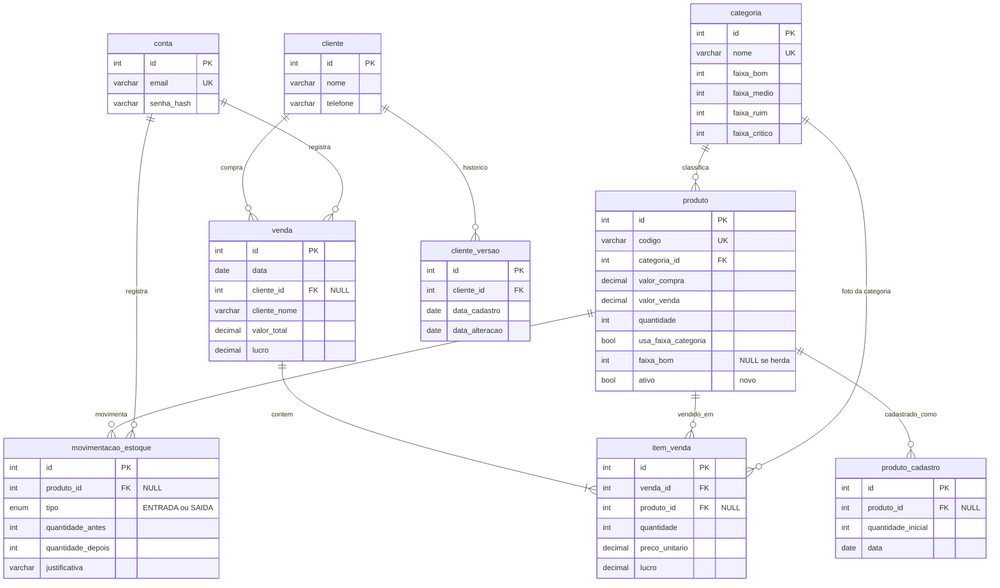

# Modelagem de dados (MySQL)

Modelo do banco para o front atual (Etapas 1 a 21). O script completo está em [`docs/banco/schema.sql`](banco/schema.sql) (MySQL 8.0.16 ou superior, por causa das restrições `CHECK`). O que **não** existe hoje no front aparece marcado como **novo**.

## Decisões principais

1. **O estado do estoque não é coluna.** Crítico, Ruim, Médio e Bom saem da quantidade e da faixa efetiva do produto. Guardar o estado criaria um dado que fica velho a cada venda, entrada, saída ou edição de faixa. No banco ele sai da view `vw_produto_estoque`.
2. **Faixa por categoria, com exceção por produto.** A categoria tem as 4 faixas. O produto herda (`usa_faixa_categoria = 1`, faixas `NULL`) ou tem as suas (`usa_faixa_categoria = 0`, 4 faixas obrigatórias). Editar a faixa da categoria muda só quem herda.
3. **Venda é uma foto.** `venda` e `item_venda` guardam preço, lucro, código e nomes da época. Mudar o preço, o nome ou a categoria de um produto depois não altera o histórico nem o Dashboard de vendas.
4. **Excluir conta remove só o acesso.** `venda.conta_id` e `movimentacao_estoque.conta_id` viram `NULL` (`ON DELETE SET NULL`); os dados da empresa ficam.
5. **Dinheiro em `DECIMAL(10,2)`**, nunca `FLOAT`. Datas em `DATE`, porque o front só trabalha com dia.

## Diagrama



## Tabelas

| Tabela | Para que serve | Observações |
| --- | --- | --- |
| `conta` | Contas de acesso | `email` único; só `senha_hash` (hoje a senha do mock é texto, só por ser mock). Todas as contas têm as mesmas permissões |
| `categoria` | Categorias e a faixa padrão | `nome` único; `CHECK bom ≥ médio ≥ ruim ≥ crítico`; não pode ser excluída com produtos (`RESTRICT`) |
| `produto` | Catálogo e quantidade atual | `codigo` único; `quantidade` sem sinal; `CHECK` da faixa própria; **sem coluna `estado`** |
| `cliente` | Dados atuais do cliente | |
| `cliente_versao` | Aba "Alteração de Clientes" | Uma linha por versão; a primeira é o cadastro (`data_alteracao = data_cadastro`) |
| `venda` | Cabeçalho da venda | `cliente_id` opcional; `cliente_nome` gravado; `CHECK valor_total = subtotal − descontos` |
| `item_venda` | Linhas da venda | Foto do momento; `CHECK total = valor_linha − desconto` |
| `movimentacao_estoque` | Entradas e saídas (Histórico) | Venda **não** entra aqui (como no front); `CHECK` das quantidades e justificativa obrigatória na saída |
| `produto_cadastro` | Aba "Cadastro de Produtos" | Dados do produto como estavam no cadastro |

O **carrinho** continua só no front (não é gravado). A senha, o estado do estoque e os percentuais do Dashboard são calculados, não guardados.

## Regras de integridade

| Regra do sistema | Como o banco garante |
| --- | --- |
| Quantidade nunca negativa | `quantidade INT UNSIGNED` e atualização dentro de transação com `SELECT ... FOR UPDATE` (exemplo no fim do `schema.sql`) |
| Faixa em ordem (`bom ≥ médio ≥ ruim ≥ crítico`) | `CHECK` em `categoria` e em `produto` |
| Produto herda **ou** tem faixa própria | `CHECK ck_produto_faixa` (herda = faixas `NULL`; própria = as 4 preenchidas) |
| Não excluir categoria com produtos | `FOREIGN KEY ... ON DELETE RESTRICT` |
| Saída exige justificativa | `CHECK ck_movimentacao_justificativa` |
| Saldo antes/depois coerente | `CHECK ck_movimentacao_quantidade` |
| Histórico não muda quando o produto muda | Colunas de nome, categoria, preço e lucro copiadas em `item_venda`, `movimentacao_estoque` e `produto_cadastro` |
| Excluir cliente ou produto não apaga vendas | `ON DELETE SET NULL` nas chaves de `venda` e `item_venda`, com os nomes gravados |
| Excluir conta só tira o acesso | `conta_id` das vendas e movimentações com `ON DELETE SET NULL` |

## Do front para o banco

| No front | No banco |
| --- | --- |
| `produto.categoriaId` | `produto.categoria_id` |
| `produto.faixaPropria` (`null` ou `{ bom, medio, ruim, critico }`) | `usa_faixa_categoria` + `faixa_bom/medio/ruim/critico` |
| `categoria.criterios` | `categoria.faixa_bom/medio/ruim/critico` |
| `produto.faixa`, `faixaOrigem`, `estado` (calculados por `comEstoqueCalculado`) | colunas `faixa_*`, `faixa_origem` e `estado` da view `vw_produto_estoque` |
| `produto.imagem` (data URL) | `produto.imagem_url` (arquivo no storage) |
| `venda.valor` | `venda.valor_total` |
| `venda.itens[]` | `item_venda` (`precoUnitario` → `preco_unitario`, `lucroUnitario` → `lucro_unitario`, `valorLinha` → `valor_linha`) |
| `entradas[]` e `saidas[]` | `movimentacao_estoque` com `tipo = 'ENTRADA'` ou `'SAIDA'` |
| `cadastrosProdutos[]` | `produto_cadastro` |
| `cadastrosClientes[]` | `cliente_versao` |

## Consultas do Dashboard

Rosca e tabela de estoque (a rosca é a contagem por estado; "Precisam de reposição" é Ruim + Crítico):

```sql
SELECT estado, COUNT(*) AS quantidade
FROM vw_produto_estoque
GROUP BY estado;

SELECT COUNT(*) AS precisam_de_reposicao
FROM vw_produto_estoque
WHERE estado IN ('Ruim', 'Crítico');
```

Indicadores de vendas no período (`:inicio`, `:fim`; com filtro de categoria, some só os itens dessas categorias):

```sql
SELECT COUNT(DISTINCT v.id)                        AS vendas,
       SUM(i.total)                                AS faturamento,
       SUM(i.lucro)                                AS lucro,
       SUM(i.total) / NULLIF(SUM(i.quantidade), 0) AS preco_medio
FROM venda v
JOIN item_venda i ON i.venda_id = v.id
WHERE v.data BETWEEN :inicio AND :fim
  AND i.categoria_id IN (:categorias);
```

Top 10 produtos mais vendidos:

```sql
SELECT i.codigo, i.nome, SUM(i.quantidade) AS quantidade, SUM(i.total) AS faturamento
FROM venda v
JOIN item_venda i ON i.venda_id = v.id
WHERE v.data BETWEEN :inicio AND :fim
  AND i.categoria_id IN (:categorias)
GROUP BY i.codigo, i.nome
ORDER BY quantidade DESC
LIMIT 10;
```

Os índices `ix_venda_data`, `ix_item_venda_venda` e `ix_item_venda_categoria` sustentam essas consultas.

## Pontos em aberto (para o time decidir)

1. **Excluir produto com histórico.** O schema já aceita (`SET NULL` + nomes gravados), mas a coluna **nova** `produto.ativo` permite desativar em vez de apagar. A view só lista produtos ativos.
2. **Excluir cliente.** As vendas ficam (`cliente_nome` gravado). As versões em `cliente_versao` são apagadas junto (`CASCADE`); se o time quiser guardar o histórico de clientes excluídos, trocar para `SET NULL` e gravar o nome.
3. **Quem registrou** (`conta_id`, **novo**): o front não mostra, mas dá auditoria sem custo. Pode ser removido se não for desejado.
4. **Imagens:** guardar o arquivo em storage e só o endereço no banco.
5. **Hora das movimentações:** o front usa só a data. Trocar `DATE` por `DATETIME` se o time quiser a hora.
6. **Cálculo do estado:** pode ficar na view (acima) ou continuar no front com `comEstoqueCalculado`. Com view, as regras ficam em um só lugar para qualquer outro cliente do banco.
7. **Validação:** o script não foi executado em um servidor MySQL neste ambiente (não havia um instalado). Rodar em um MySQL 8.0.16+ antes de adotar.
